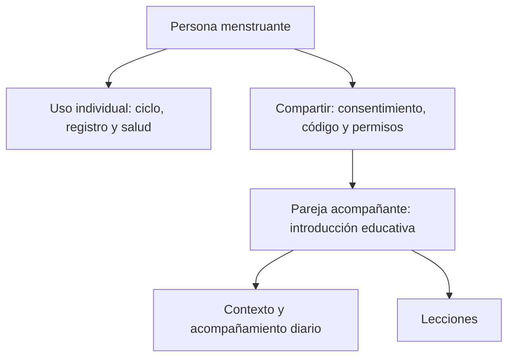
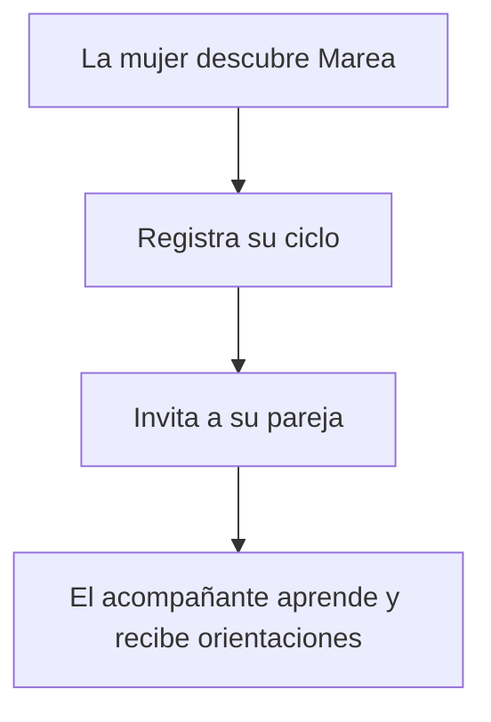
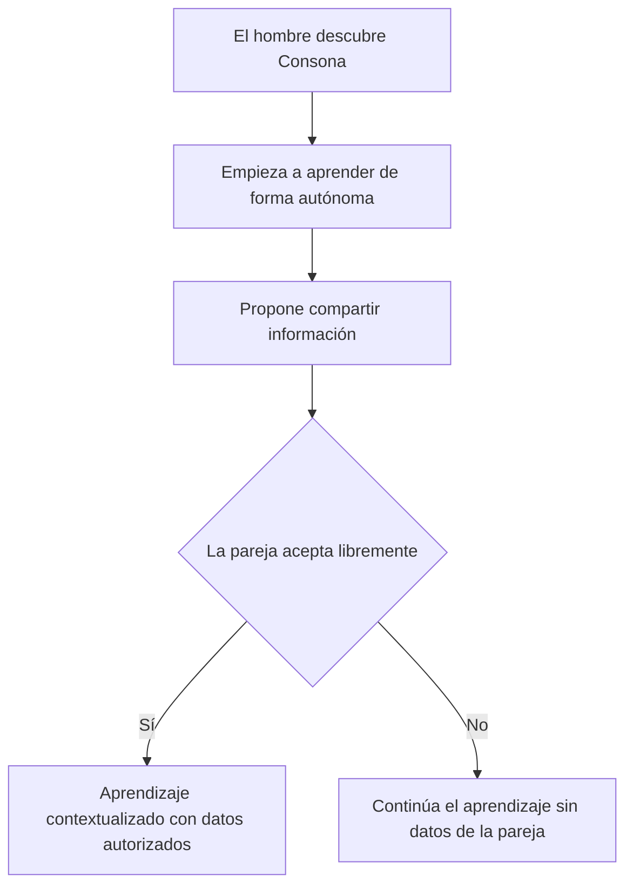

# Marea: análisis de producto y benchmarking estratégico para Consona

**Fecha del análisis original:** 24 de noviembre de 2026.  
**Tipo de documento:** benchmarking documental de producto, experiencia de usuario, pedagogía y posicionamiento.  
**Estado:** exploratorio; pendiente de auditoría funcional de la aplicación (JUA-59).  
**Origen:** elaborado con ChatGPT a partir de material promocional, fichas de tiendas y la web de Marea. No se probó la aplicación. Sus datos sobre Marea están **sin verificar** y no deben citarse como evidencia externa.  
**Contraste con Consona:** revisado el 24-11-2026 contra la documentación del proyecto (JUA-51). Las notas «Contraste con Consona» corrigen o actualizan el texto original sin reescribirlo. Las decisiones están en la sección 17.

> Este documento no es una decisión de producto. Las decisiones vigentes de Consona están en ADR-001, ADR-002, la línea base y Linear. Marea es una aplicación de seguimiento menstrual en pareja; Consona es una herramienta de alfabetización menstrual dirigida principalmente a hombres.

## 0. Resumen ejecutivo

Marea es una aplicación de seguimiento menstrual y bienestar que ofrece una experiencia diferenciada para la pareja acompañante. No es, en sentido estricto, una aplicación de alfabetización menstrual concebida principalmente para hombres.

Para Consona, constituye un **competidor indirecto de alta proximidad funcional y un referente prioritario de experiencia de usuario, consentimiento y microaprendizaje contextual**.

La diferencia fundamental es quién protagoniza el producto, quién tiene la iniciativa y qué necesidad se pretende resolver. En Marea, la experiencia de seguimiento menstrual de la persona menstruante tiene valor por sí misma; la experiencia de pareja se añade a ella. En Consona, el hombre es el destinatario principal de la propuesta educativa y debe poder aprender sin que su pareja tenga que compartir datos o participar en la aplicación.

> **Contraste con Consona (24-11-2026).** La frase anterior es una propuesta del benchmarking, no el posicionamiento actual. Consona se diseña en torno al modelo E, con la participación y el consentimiento de ella desde su propia app (JUA-41, JUA-42); el modelo A, educación sin datos de ella, es la contingencia. **Decisión:** el modo sin vínculo es una experiencia parcial, centrada en «Comprender» (JUA-52), no una experiencia completa, al menos al principio.

Las principales oportunidades de aprendizaje identificadas son:

- Separación de la experiencia de la persona menstruante y la del acompañante.
- Transformación del dato menstrual en información comprensible, aprendizaje y propuestas de acción.
- Microaprendizaje contextual combinado con lecciones estructuradas.
- Onboarding educativo que introduce normas éticas de acompañamiento.
- Consentimiento granular, revocación y autonomía de la persona menstruante.
- Orientaciones cotidianas que contemplan tanto el apoyo en situaciones difíciles como las experiencias positivas de pareja.

El posicionamiento diferencial propuesto para Consona es **la alfabetización menstrual masculina como competencia relacional autónoma**, no la predicción del comportamiento de la mujer.

> Pregunta estratégica: si mañana el hombre dejara de recibir información sobre el ciclo de su pareja, ¿seguiría siendo un mejor acompañante gracias a lo aprendido?

## 1. Posicionamiento y relación competitiva

| Dimensión | Marea | Consona |
| --- | --- | --- |
| Centro del producto | Ciclo menstrual | Alfabetización menstrual masculina |
| Usuario principal | Persona menstruante | Hombre en pareja |
| Usuario secundario | Pareja acompañante | Mujer que decide participar o compartir información |
| Necesidad inicial | Conocer y registrar el propio ciclo | Comprender y acompañar mejor |
| Orientación | Salud, bienestar y relación | Educación y relación |
| Adquisición natural prevista | La mujer incorpora a su pareja | El hombre descubre la herramienta |
| Categoría competitiva | Femtech y aplicaciones de pareja | Educación menstrual y bienestar relacional |
| Valor diferencial | Compartir información menstrual interpretada | Desarrollar competencias de acompañamiento |

La estrategia de adquisición atribuida a Marea es una inferencia a partir de su diseño y comunicación, no una constatación basada en datos de usuarios. La columna de Consona recoge el posicionamiento trabajado hasta ahora y propuestas de este benchmarking, no especificaciones necesariamente aprobadas.

## 2. Identificación y contexto empresarial

| Campo | Información recogida en el análisis original |
| --- | --- |
| Nombre | Marea |
| Desarrollador | Wealthia S.A.S. |
| Procedencia | Quito, Ecuador |
| Lanzamiento identificado | Octubre de 2026; primera versión Android fechada el 5 de octubre |
| Idiomas | Español, inglés y portugués |
| Plataformas | Android, iOS y Apple Watch |
| Modelo de negocio | Freemium y suscripciones |
| Web | <https://usemarea.app/> |
| Google Play | <https://play.google.com/store/apps/details?id=app.usemarea> |
| App Store | <https://apps.apple.com/es/app/marea-regla-y-ciclo-menstrual/id6814903604> |
| Privacidad | <https://usemarea.app/privacidad> |

Los datos de esta tabla son los recogidos en el análisis previo. Las fichas comerciales son dinámicas y conviene volver a verificarlas antes de utilizar las cifras o fechas como evidencia externa.

### 2.1. Empresa desarrolladora

Wealthia presenta un catálogo de productos digitales que incluye Finly (finanzas personales), Finly Negocios (gestión comercial), Investable (preparación de rondas de financiación) y Vantage (información para inversores).

Esto sugiere una estructura empresarial orientada al desarrollo de distintos productos digitales, más que una organización nacida exclusivamente de la educación menstrual. Se trata de una hipótesis estratégica, no de una conclusión sobre las motivaciones o competencias del equipo.

No se ha identificado de manera verificable al equipo científico, profesionales sanitarios asociados o responsables de los contenidos pedagógicos de Marea.

## 3. Penetración en el mercado y madurez

En el análisis original, Google Play mostraba el tramo de 50+ descargas y la App Store española no publicaba una puntuación agregada por falta de valoraciones suficientes. El directorio Debuts recogía el lanzamiento, pero sin valoraciones de usuarios identificadas.

No se han localizado cifras de facturación, financiación, usuarios activos, tasas de conversión, retención o parejas vinculadas. La puntuación editorial de un directorio de lanzamientos no equivale a satisfacción de usuarios.

**Implicación para Consona:** Marea indica que otros desarrolladores identifican una necesidad similar, pero no permite concluir que exista un mercado comercialmente validado. Las cifras anteriores son una fotografía preliminar de las tiendas, no métricas auditadas ni actuales garantizadas.

## 4. Arquitectura del producto y experiencia de usuario

### 4.1. Persona menstruante

En las capturas promocionales se identifican cinco áreas principales: hoy, ciclo, registro, salud y compartir. El producto ofrece una experiencia de seguimiento menstrual y bienestar, con funciones adicionales de IA y conexión con dispositivos de salud.

La funcionalidad de pareja constituye una extensión de esta experiencia, no un requisito para que el producto tenga valor.

### 4.2. Pareja acompañante

La interfaz promocional del acompañante presenta dos áreas principales:

| Pestaña | Función |
| --- | --- |
| Today / Hoy | Contexto del ciclo y sugerencias prácticas |
| Lessons / Lecciones | Aprendizaje menstrual |

[Captura promocional de la interfaz del acompañante](https://is1-ssl.mzstatic.com/image/thumb/PurpleSource221/v4/c9/95/a7/c995a792-c9b7-637f-f32a-684b04b0aaff/02.png/320x480bb.jpg)

La pantalla diaria muestra tres componentes:

1. Previsión visual de los próximos siete días.
2. Interpretación de lo que la pareja podría experimentar.
3. Propuestas concretas de acompañamiento.

No se trata simplemente de replicar el calendario menstrual de la mujer en el teléfono del acompañante. Existe una capa editorial que transforma la información en orientaciones.

**Hallazgo principal: separar el dato, su interpretación educativa y la acción relacional.**

### 4.3. Reconstrucción conceptual del recorrido

El diagrama reconstruye el recorrido a partir de materiales promocionales; no representa una arquitectura técnica verificada ni todas las rutas posibles de acceso.

## 5. Estrategia de acompañamiento masculino

### 5.1. Necesidad que aborda

La comunicación de Marea sitúa al acompañante como alguien que quiere ayudar, pero que puede no saber cómo hacerlo. No convierte necesariamente el desconocimiento en un motivo de culpa, sino en una oportunidad de aprendizaje.

| Motivación | Necesidad del hombre |
| --- | --- |
| Cognitiva | Entender qué sucede |
| Emocional | Sentirse capaz de acompañar |
| Práctica | Saber cómo actuar en situaciones cotidianas |

Es una aproximación potencialmente más accesible para captar usuarios que presentar la alfabetización menstrual únicamente como obligación educativa o responsabilidad social. Su eficacia real de captación no está demostrada.

### 5.2. Orientaciones cotidianas

En una captura promocional se proponen actividades como cocinar algo nuevo juntos, romper la rutina, tomar la iniciativa al hacer planes o hacerse una fotografía juntos. Son ejemplos observados en el material comercial, no un inventario de todo el contenido.

La propuesta no se limita a la gestión del dolor o de posibles conflictos premenstruales. También contempla experiencias positivas y oportunidades para fortalecer la relación.

La reserva es que algunas sugerencias podrían proceder de cualquier aplicación de bienestar de pareja. No está claro que su pertinencia dependa necesariamente del momento del ciclo.

Para Consona se propone distinguir tres capas editoriales:

| Capa | Ejemplo de contenido propuesto |
| --- | --- |
| Conocimiento menstrual | Aprender qué es la fase lútea |
| Aplicación relacional | Aprender a preguntar por las necesidades de la pareja |
| Acción cotidiana | Ofrecer ayuda con una tarea pendiente o preparar la cena |

Las acciones deben consolidar el aprendizaje, no sustituirlo.

### 5.3. Microaprendizaje contextual

Marea parece combinar tres modalidades:

- **Aprendizaje estructurado:** lecciones consultables voluntariamente.
- **Aprendizaje contextual:** información que adquiere relevancia en un momento del ciclo.
- **Aprendizaje mediante la acción:** propuestas para trasladar el conocimiento a la relación.

El interés para Consona reside en introducir conocimientos de forma progresiva, en lugar de exigir un curso completo de menstruación antes de poder utilizar el producto.

Se recomienda que las lecciones también puedan explorarse libremente, sin datos compartidos y sin esperar a una fase concreta.

## 6. Onboarding, vinculación y consentimiento

### 6.1. Onboarding como acuerdo ético

La descripción pública de Marea apunta a una introducción educativa para el acompañante antes de acceder a la experiencia vinculada. Incluye el ciclo menstrual y el uso responsable de la información. No se ha comprobado su secuencia completa, obligatoriedad exacta ni número de pantallas mediante el uso de la aplicación.

Consona puede ampliar esta idea mediante seis principios editoriales y de relación:

| Principio | Mensaje propuesto |
| --- | --- |
| Individualidad | No todas las mujeres experimentan el ciclo de la misma manera. |
| Incertidumbre | Conocer una fase no significa conocer un estado emocional. |
| Comunicación | Preguntar es preferible a presuponer. |
| Autonomía | Tu pareja decide qué información comparte. |
| Respeto | El ciclo no invalida sentimientos, opiniones o argumentos. |
| Corresponsabilidad | Aprender no es responsabilidad exclusiva de tu pareja. |

El onboarding puede funcionar como una declaración de principios de Consona, además de explicar las funcionalidades.

### 6.2. Inversión del recorrido de adquisición

**Recorrido previsto de Marea (inferencia):**

**Recorrido propuesto para Consona:**

El hombre debe obtener valor antes de que la mujer participe y aunque decida no participar nunca. Esto reduce barreras de entrada, evita trasladar a la mujer la responsabilidad de activar el aprendizaje y amplía el alcance de la propuesta educativa.

Está pendiente comprobar si las lecciones de Marea pueden utilizarse sin vinculación y si el acompañante puede iniciar el proceso de adquisición.

> **Contraste con Consona (24-11-2026).** El recorrido coincide con el de Consona: él descubre la app y ella consiente desde la suya. Pero sin ella el valor es parcial, no completo (JUA-52). Cómo propone él compartir y cómo puede rechazarlo ella sin que él lo vea sigue pendiente de decisión (JUA-54).

## 7. Privacidad y tratamiento de datos

### 7.1. Permisos diferenciados

Los materiales promocionales muestran controles separados de compartición de información. Entre las categorías identificadas en el análisis original se incluyen:

| Categoría | Observación |
| --- | --- |
| Fase actual | Contexto menstrual |
| Cambios de fase | Notificaciones |
| Estado de ánimo y energía | Orientaciones generales |
| Síntomas físicos | Información sobre posibles molestias |
| Deseo sexual | Información especialmente íntima |
| Notas del diario | Información personal |

[Captura promocional de los controles de compartición](https://is1-ssl.mzstatic.com/image/thumb/PurpleSource211/v4/85/f6/e5/85f6e572-8eff-9bd3-36b0-520ffd5cbd25/03.png/320x480bb.jpg)

Las categorías son una reconstrucción ilustrativa. No se han verificado los permisos por defecto, los datos exactos accesibles en cada permiso o los efectos reales de su revocación.

La posibilidad de limitar qué se comparte y de desvincularse unilateralmente es una referencia de diseño relevante para Consona. No implica que deban reproducirse todas las categorías.

### 7.2. Datos originales frente a datos derivados

| Dato original | Ejemplo de información derivada |
| --- | --- |
| Fecha de inicio menstrual | Fase estimada |
| Registro de síntomas | Contexto de bienestar |
| Diario personal | Orientación de acompañamiento |
| Registro del deseo sexual | Información interpretada, si está autorizada |

Marea presenta la idea de compartir información interpretada en lugar de trasladar indiscriminadamente registros originales. La implementación exacta permanece sin verificar.

Una información derivada puede seguir siendo un dato personal de salud especialmente protegido. Sustituir una fecha exacta por una fase estimada no elimina automáticamente los riesgos de privacidad ni las obligaciones legales aplicables.

Para Consona se propone priorizar la minimización de datos frente a la acumulación de permisos. No es necesario registrar libido, diarios íntimos o estados emocionales por el mero hecho de que Marea contemple esas posibilidades.

### 7.3. Privacidad técnica pendiente de verificar

Las fichas de las tiendas recogen declaraciones del desarrollador sobre cifrado en tránsito, eliminación de datos y ausencia de determinados usos publicitarios o de seguimiento. Son declaraciones del proveedor, no conclusiones de una auditoría independiente.

No se ha verificado:

- Cifrado de extremo a extremo ni cifrado en reposo.
- Arquitectura y protocolo de sincronización.
- Proveedores de infraestructura y ubicación de servidores.
- Periodos de conservación y eliminación efectiva.
- Información transmitida a proveedores de IA.
- Tratamiento de copias de seguridad y datos ya sincronizados tras revocación.
- Cumplimiento efectivo del RGPD.

Google Play contempla excepciones en su definición de compartición con terceros para determinados proveedores de servicios. Una declaración de que no se comparten datos no demuestra por sí sola que ningún procesador externo los reciba.

**Conclusión:** Marea es una referencia de diseño del consentimiento, no una referencia acreditada de arquitectura de seguridad ni de cumplimiento normativo.

## 8. Rigor científico y perspectiva de género

### 8.1. Interpretación emocional del ciclo

Marea presenta cinco momentos del ciclo, subdividiendo la fase lútea. Sus materiales promocionales relacionan estos momentos con determinadas experiencias físicas y emocionales.

La existencia de fluctuaciones hormonales y posibles cambios de bienestar no justifica inferir de forma fiable el estado emocional de una persona concreta a partir de una fase estimada. La literatura científica apunta a variabilidad individual y resultados heterogéneos.

Conviene distinguir la divulgación de tendencias poblacionales, el relato individual de síntomas y las predicciones personalizadas. Las referencias científicas específicas mencionadas en el análisis anterior no disponen aquí de una ficha bibliográfica verificable; se deben recuperar y validar antes de citar el documento externamente como evidencia científica.

### 8.2. Política editorial no determinista

Ejemplos elaborados para Consona, no citas de Marea:

| Evitar | Preferir |
| --- | --- |
| Ahora estará más irritable. | Algunas personas experimentan cambios emocionales durante esta fase. |
| Evita conversaciones importantes. | Buscad un momento adecuado para ambos si necesitáis hablar. |
| Hoy tendrá más deseo sexual. | El deseo puede variar durante el ciclo y depende de muchos otros factores. |
| Necesita estar sola. | Pregúntale si prefiere compañía o espacio. |
| Está en una fase de poca energía. | Puede experimentar cansancio; no presupongas que sea así. |

Propuesta: formular contenidos que expliquen posibilidades, reconozcan incertidumbre y fomenten comunicación directa, sin utilizar el ciclo como explicación automática de opiniones, conflictos o comportamientos.

> **Contraste con Consona (24-11-2026).** La tabla no se adopta. Algunas frases de la columna «Preferir» no cumplen las reglas de Consona: «Puede experimentar cansancio» presenta un cambio como algo que tu pareja va a tener (H-02), y «Algunas personas experimentan cambios emocionales durante esta fase» atribuye el ánimo a la fase (H-08). Prevalecen las reglas H-01 a H-09 de `docs/education/home-cards-index.md`, que pasan al relato del producto como ventaja diferencial (JUA-57).

### 8.3. Astrología y compatibilidad

El análisis de la oferta comercial de Marea identificó un módulo opcional de astrología denominado Cielo y contenidos de compatibilidad de pareja.

Desde la perspectiva empresarial, esto puede ampliar la oferta y las vías de monetización. Desde la perspectiva pedagógica, plantea un problema de coherencia entre contenidos de salud y contenidos que no tienen una base científica equivalente.

Consona puede diferenciarse mediante criterios explícitos de calidad editorial, referencias comprobables, autoría identificada y revisión profesional.

## 9. Identidad visual, tono y comunicación

Las capturas oficiales muestran tonos crema, granate, rosa suave, verde y lavanda. Paleta aproximada interpretada visualmente, no manual de marca: `#F8F3EF`, `#711538`, `#F1D8DD`, `#42A36C`, `#D8D9EF`.

La comunicación busca transmitir intimidad, calma y confianza. La experiencia del acompañante no recurre a una estética masculina estereotipada y comparte identidad con la experiencia menstrual principal, pese a tener menor complejidad funcional.

Para Consona:

- Evitar parecer una aplicación menstrual femenina a la que se ha añadido una función para hombres.
- Construir una identidad desde la conexión, el conocimiento, la escucha, la sincronía y el cuidado.
- No asumir que dirigirse a hombres obliga a emplear códigos visuales tradicionalmente masculinos.

Marea remite semánticamente a procesos cíclicos; Consona puede remitir a la relación entre personas. La diferencia puede trasladarse al posicionamiento y a la identidad de marca.

## 10. Modelo de negocio

Precios de App Store España recogidos en el análisis original, sujetos a comprobación:

| Plan | Mensual | Anual | Propuesta identificada |
| --- | ---: | ---: | --- |
| Marea Gratis | 0 € | 0 € | Acceso básico y contenidos educativos y de salud |
| Marea+ | 2,99 € | 22,99 € | Mayor acceso a IA y astrología |
| Marea Duo | 3,99 € | 34,99 € | Funciones adicionales de pareja y compatibilidad |

También se identificó una oferta de prueba de siete días sin tarjeta inicial ni suscripción automática; sus condiciones exactas requieren comprobación.

La estrategia parece mantener una parte educativa básica gratuita y reservar experiencias adicionales a la suscripción. Constituye una referencia de estructura y precios, no evidencia de disposición real a pagar.

No se dispone de información sobre quién paga (la mujer, el hombre o ambos), conversión, rentabilidad o retención.

## 11. DAFO de Marea

Análisis cualitativo e hipotético; no representa problemas internos constatados.

| Fortalezas | Debilidades |
| --- | --- |
| Experiencia diferenciada del acompañante | Posible dispersión funcional |
| Microaprendizaje contextual | Rigor pedagógico no acreditado |
| Consentimiento granular | Convivencia de ciencia y astrología |
| Orientaciones prácticas | Posible dependencia de la iniciativa femenina |
| Precios accesibles | Tratamiento de numerosos datos sensibles |
| Posicionamiento inclusivo | Falta de información sobre impacto educativo |

| Oportunidades | Amenazas |
| --- | --- |
| Mercado hispanohablante | Competencia de grandes apps menstruales |
| Bienestar relacional | Dificultad de activar a dos usuarios |
| Educación menstrual masculina | Riesgos reputacionales por privacidad |
| Alianzas con profesionales sanitarios | Percepción de estereotipos de género |
| Suscripciones compartidas | Posible baja retención del acompañante |

## 12. Aprendizajes aplicables a Consona

Las prioridades siguientes son recomendaciones de benchmarking, no decisiones de producto aprobadas ni modificaciones automáticas del backlog.

| Elemento de Marea | Prioridad propuesta | Decisión propuesta |
| --- | --- | --- |
| Experiencia específica del acompañante | Muy alta | Incorporar como experiencia principal |
| Introducción educativa | Muy alta | Desarrollar onboarding propio |
| Microaprendizaje contextual | Muy alta | Adaptar y ampliar |
| Recomendaciones prácticas | Muy alta | Incorporar sin determinismo |
| Separación de datos originales y derivados | Muy alta | Estudiar técnica y jurídicamente |
| Revocación unilateral | Muy alta | Incorporar |
| Emparejamiento mediante código | Alta | Contrastar con las opciones ya estudiadas |
| Notificaciones de cambio de fase | Alta | Incorporar opcionalmente |
| Biblioteca de lecciones | Alta | Convertir en pilar del producto |
| Permisos granulares | Alta | Adaptar a los datos estrictamente necesarios |
| Calendario menstrual completo para la mujer | Baja | No prioritario para el MVP |
| Suscripción compartida | Media | Estudiar posteriormente |
| Chat con IA | Baja | No necesario inicialmente |
| Dispositivos biométricos | Baja | Fuera del alcance inicial propuesto |
| Registro de libido e intimidad | Baja | Evitar inicialmente |
| Astrología | Nula | No incorporar |

> **Contraste con Consona (24-11-2026).** Varias filas ya estaban decididas o se han decidido de otro modo:
>
> - **Experiencia del acompañante, revocación unilateral, permisos granulares, calendario mínimo para ella:** ya decididos (público de Consona, CON-007, DA-03, DA-10, ADR-002 §3, JUA-41).
> - **Separación de datos originales y derivados:** decidido en JUA-42 (19-11-2026). Viajan fechas y duraciones cifradas de extremo a extremo; la fase la calcula el dispositivo de él; ningún derivado pasa por el servidor (ADR-001 §2).
> - **Emparejamiento mediante código:** decidido en JUA-42 §4.4. Código corto de verificación, sin QR en la primera versión.
> - **Notificaciones de cambio de fase:** sin push. Sí dentro de la app, al abrirla, como enlace al aprendizaje de la fase (JUA-56).
> - **Microaprendizaje contextual y recomendaciones prácticas:** ya existen como tarjetas de la home e ideas para hoy (JUA-23, JUA-50).
> - **Biblioteca de lecciones:** «Comprender» (JUA-31) sube a prioridad alta.

## 13. Oportunidad diferencial y medición de impacto

El posicionamiento conceptual puede representarse con dos ejes: orientación educativa y protagonismo del usuario masculino.

| Categoría | Orientación educativa | Protagonismo masculino |
| --- | --- | --- |
| Trackers menstruales tradicionales | Baja | Bajo |
| Trackers dirigidos a hombres | Baja o variable | Alto |
| Marea | Media, pendiente de evaluación | Medio; el acompañante dispone de experiencia propia |
| Cursos de educación menstrual para hombres | Alta | Alto |
| Consona (objetivo) | Alta | Alto |

Esta clasificación es cualitativa y no procede de mediciones de mercado. La diferencia frente a los cursos sería integrar el aprendizaje autónomo con la posibilidad de aprendizaje contextual, mediante información compartida voluntariamente.

El éxito no debería medirse exclusivamente por la frecuencia de uso ni por la cantidad de información menstrual registrada.

| Indicador habitual de un tracker | Indicador potencial de Consona |
| --- | --- |
| Ciclos registrados | Conocimientos adquiridos |
| Frecuencia de registro | Continuidad del aprendizaje |
| Precisión de las predicciones | Comprensión de la variabilidad menstrual |
| Parejas vinculadas | Mejora percibida del acompañamiento |
| Usuarios activos diarios | Aplicación de lo aprendido a la vida cotidiana |
| Datos introducidos | Autonomía educativa del hombre |

Para evaluar la mejora del acompañamiento, conviene evitar que el hombre sea el único juez de su desempeño. Podrían utilizarse, con consentimiento y sin exigir participación de la mujer, cuestionarios voluntarios de conocimientos y medidas de percepción de ambos miembros. Los instrumentos concretos y su validación quedan pendientes.

> **Contraste con Consona (24-11-2026).** Estos indicadores no se pueden medir dentro de la app: no hay analítica (CON-014) ni indicadores de «leído», progreso o rachas. **Decisión:** se miden fuera de la app, en el piloto, con cuestionarios voluntarios y consentimiento propio (JUA-58).

## 14. Protocolo de auditoría práctica de Marea

Utilizar dos perfiles de prueba y datos menstruales ficticios. No introducir datos íntimos reales de terceros.

- [ ] Comprobar si el acompañante puede registrarse primero.
- [ ] Comprobar si puede aprender sin vincularse a una pareja.
- [ ] Documentar todas las pantallas del onboarding del acompañante.
- [ ] Inventariar lecciones y recursos disponibles para el acompañante.
- [ ] Examinar información y recomendaciones de los cinco momentos del ciclo.
- [ ] Comprobar cómo funcionan los códigos de emparejamiento.
- [ ] Revisar qué permisos se activan inicialmente.
- [ ] Probar la revocación individual de permisos.
- [ ] Comprobar qué ocurre al desvincular ambos perfiles.
- [ ] Examinar los cambios al corregir un registro menstrual.
- [ ] Analizar las notificaciones, su lenguaje y frecuencia.
- [ ] Identificar funcionalidades gratuitas y de pago.
- [ ] Comprobar exportación y eliminación de datos.
- [ ] Examinar referencias científicas y autoría de las lecciones.

### Ficha de registro de cada hallazgo

| Campo | Registro |
| --- | --- |
| ID | |
| Fecha y versión de la app | |
| Plataforma y perfil | |
| Pantalla o funcionalidad | |
| Pasos para reproducir | |
| Comportamiento observado | |
| Captura o evidencia | |
| Interpretación | |
| Implicación para Consona | |
| Prioridad | |
| Estado de verificación | |

## 15. Conclusión

Marea es un **competidor indirecto de alta proximidad funcional, especializado en seguimiento menstrual compartido y acompañamiento de pareja. Referente prioritario de UX, consentimiento y microaprendizaje contextual**.

Sus principales aportaciones para Consona son la transformación de información menstrual en conocimiento aplicable, la diferenciación de las experiencias de usuario y la introducción de normas éticas en el onboarding.

Sin embargo, Marea no parece ocupar plenamente el espacio específico que Consona pretende ocupar: el desarrollo de alfabetización menstrual masculina como competencia relacional autónoma.

Consona puede diferenciarse si logra que el hombre sea más competente, autónomo y responsable en su manera de acompañar, incluso sin acceso a datos menstruales de su pareja.

> **Contraste con Consona (24-11-2026).** Se mantiene como objetivo pedagógico: lo aprendido debe servir más allá de la fase del día. Como producto, sin datos de ella la experiencia es parcial (JUA-52).

## 16. Fuentes, alcance y limitaciones

### 16.1. Enlaces primarios recuperados del análisis original

- Web oficial: <https://usemarea.app/>
- Google Play: <https://play.google.com/store/apps/details?id=app.usemarea>
- App Store España: <https://apps.apple.com/es/app/marea-regla-y-ciclo-menstrual/id6814903604>
- App Store, enlace alternativo: <https://apps.apple.com/mx/app/marea-calendario-menstrual/id6814903604>
- Privacidad: <https://usemarea.app/privacidad>
- [Captura promocional del acompañante](https://is1-ssl.mzstatic.com/image/thumb/PurpleSource221/v4/c9/95/a7/c995a792-c9b7-637f-f32a-684b04b0aaff/02.png/320x480bb.jpg)
- [Captura promocional de permisos](https://is1-ssl.mzstatic.com/image/thumb/PurpleSource211/v4/85/f6/e5/85f6e572-8eff-9bd3-36b0-520ffd5cbd25/03.png/320x480bb.jpg)

### 16.2. Limitaciones metodológicas y de exportación

- Este archivo adapta el análisis previo a Markdown portable. No supone una nueva búsqueda ni verificación independiente de sus hallazgos.
- Los enlaces son los que estaban disponibles en el análisis original; no se ha comprobado su funcionamiento en esta exportación.
- Las citas interactivas de ChatGPT no son portables a VS Code. Se han sustituido por los enlaces primarios identificables; algunas referencias empresariales, de directorios y científicas carecen aquí de una URL o ficha bibliográfica recuperada. Deben verificarse antes de una publicación externa.
- El análisis original no pudo acceder directamente a la web de Marea ni a sus textos legales completos. No se ha probado la aplicación, completado sus lecciones ni comprobado la sincronización real.
- Las afirmaciones comerciales y las capturas promocionales no son pruebas independientes del funcionamiento técnico ni del impacto educativo.
- Los datos de tiendas, fechas de versiones, precios y funciones pueden cambiar.
- No se consideran verificados la extensión exacta del onboarding, los rituales semanales, la ubicación de servidores, el cifrado de extremo a extremo ni las configuraciones por defecto.
- Los diagramas son reconstrucciones conceptuales. Las recomendaciones, el DAFO y la priorización son evaluaciones del benchmarking y no decisiones de Consona aprobadas.
- Se han sustituido los gráficos y controles interactivos del análisis original por tablas, diagramas Mermaid y listas de verificación Markdown. Mermaid requiere un visor compatible para el renderizado gráfico, pero su código fuente es legible y editable en VS Code.

## 17. Contraste con Consona y decisiones (24-11-2026)

Esta sección no forma parte del análisis original. Recoge lo que se decidió al contrastarlo con la documentación de Consona. El seguimiento está en Linear, en JUA-51 y sus subincidencias.

| Tema | Decisión | Incidencia |
| --- | --- | --- |
| Modo sin vínculo | Experiencia parcial, centrada en «Comprender», al menos al principio | JUA-52 |
| Onboarding | Se enriquece con principios de acompañamiento propios de Consona | JUA-53 |
| Invitación iniciada por él | Pendiente de decisión | JUA-54 |
| Desvinculación por parte de él | Se incorpora | JUA-55 |
| Cambio de fase | Sin push; dentro de la app, al abrirla | JUA-56 |
| Política editorial | No se adopta la tabla del §8.2; las reglas H-01 a H-09 pasan al relato del producto | JUA-57 |
| Privacidad verificable | Ventaja diferencial en el relato, sin prometer lo que aún no está construido | JUA-57 |
| Medición del aprendizaje | Fuera de la app, en el piloto | JUA-58 |
| Auditoría práctica de Marea | Con perfiles ficticios, según el §14 | JUA-59 |
| Ideas de «tiempo juntos» | Se añaden a las ideas para hoy, solo en el grupo que vale para todas las fases | JUA-50 |
| Modelo de negocio | Hipótesis por validar | JUA-61 |
| «Comprender» | Sube a prioridad alta | JUA-31 |
| Descartado | Notificaciones push de fase, chat con IA, dispositivos biométricos, registro de libido o intimidad, astrología y calendario completo para ella | JUA-51 |

**Consecuencia para la comunicación.** Marea está en español, inglés y portugués y tiene una experiencia propia para el acompañante desde octubre de 2026. Eso debilita el mensaje «primera app en castellano para hombres». Su revisión está en JUA-57.
