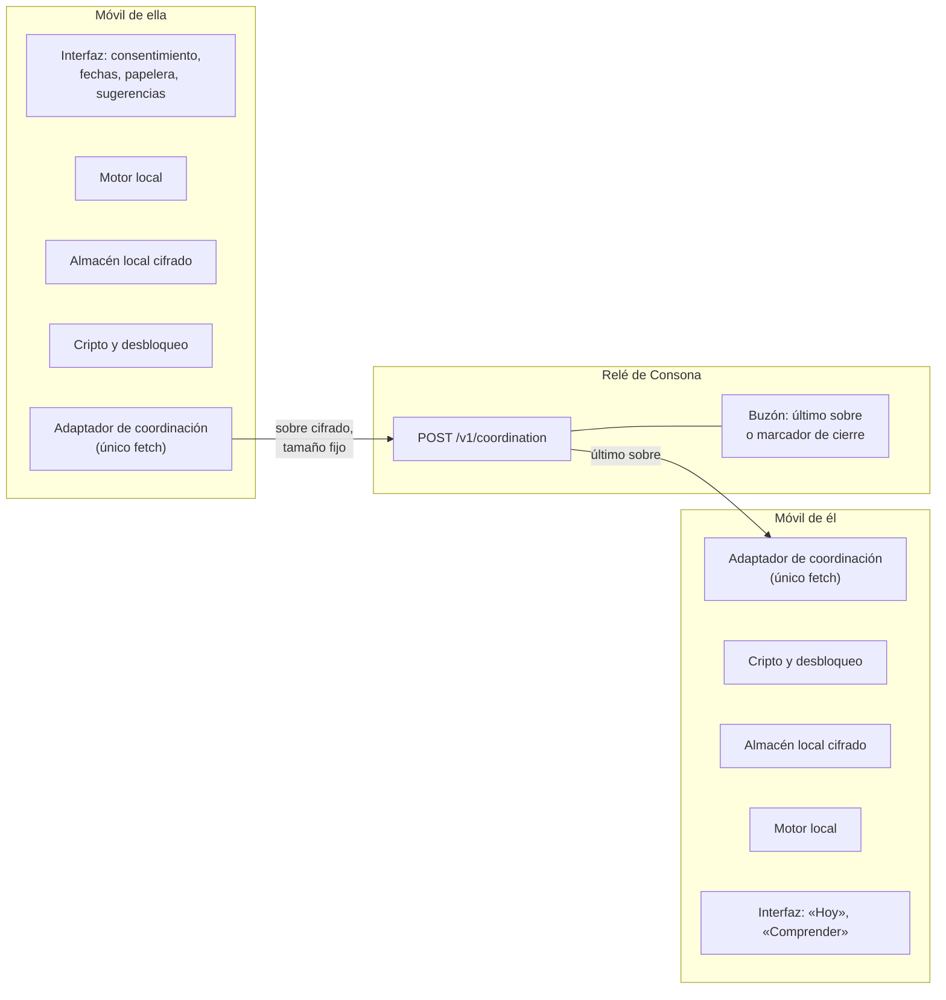
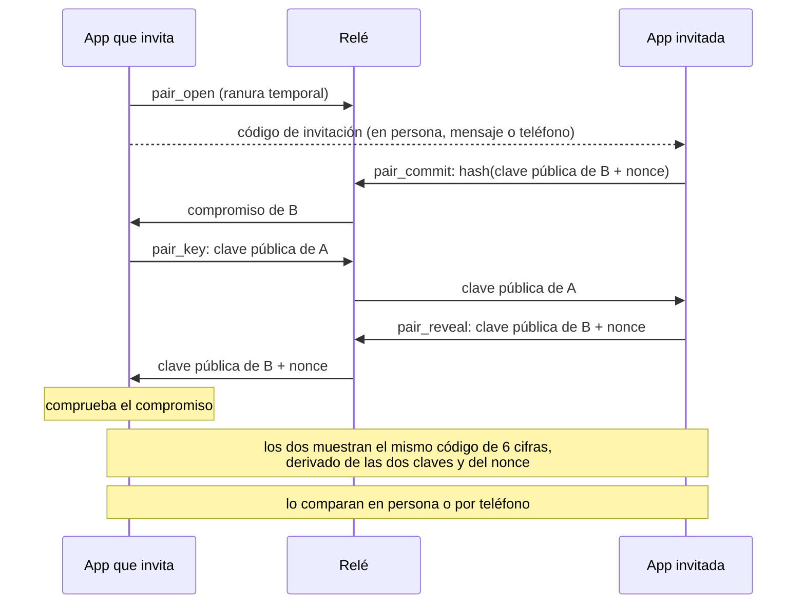

# CON-030 — Arquitectura de la primera versión del modelo E

**Estado:** primer borrador, 26-11-2026. Decididas el mismo día D-01 a D-04 y D-06 a D-08 (§12); D-05 espera a JUA-22. Pendiente de revisión por producto, seguridad e ingeniería.
**Incidencia:** JUA-47. Puerta 2 de la [ruta crítica](../governance/ruta-critica-modelo-e.md).
**Parte de:** las decisiones de la [revisión arquitectónica del modelo E](./JUA-42_REVISION_ARQUITECTONICA_MODELO_E.md) (JUA-42), [CON-007](./CON-007_AUTORIZACION_REVOCACION_Y_OFFLINE.md) y [CON-008](./CON-008_REQUERIMIENTOS_TECNICOS_Y_API.md).
**No habilita** datos reales, despliegue, emparejamiento ni piloto. Es arquitectura, no implementación (puerta 3).

> Este documento convierte las decisiones de JUA-42 en componentes, datos, claves y flujos comprobables. Cuando JUA-42 y este documento no coincidan, manda JUA-42 hasta que se corrija aquí. Las decisiones están en §12; los riesgos que pasan al modelo de amenazas, en §13.

## 0. Resumen

| Pieza | Propuesta |
|---|---|
| Clientes | Dos PWA estáticas (React + Vite) del mismo repositorio y con el mismo motor local: la de él y una mínima para ella (D-01, decidido el 26-11). La de ella puede mostrar, si ella lo pide, lo que ve él (§2.1). |
| Datos locales | IndexedDB, con cifrado en reposo mediante una clave no extraíble de Web Crypto. Nada sensible en `localStorage`, cookies ni caché del Service Worker. |
| Criptografía | Solo Web Crypto nativa, sin librerías de terceros: X25519, Ed25519, HKDF, AES-256-GCM y PBKDF2. La app exige un navegador que las tenga (D-02). |
| Emparejamiento | Siempre por el servidor, verificado con un código de 6 cifras y un compromiso previo para que el servidor no pueda forzar el código (§5.2). |
| Relé | Un único origen, una ruta `POST`, un buzón por pareja con el último sobre y un marcador de cierre. Sin cuentas, correos, cookies ni logs de contenido o IP. |
| Integridad | Proteger las cuentas y las dependencias, publicar la huella de cada versión y vigilar desde fuera que lo servido coincide con lo publicado (§9). |
| Desbloqueo | Passkey local con verificación de usuario antes de confirmar, cambiar el consentimiento, borrar, cerrar el vínculo o crear una copia (§8). |

## 1. Punto de partida

| Hoy | Consecuencia |
|---|---|
| React 19 y Vite 8, con `vite-plugin-pwa` (Workbox) en modo `autoUpdate`. | El Service Worker precachea recursos estáticos. Se mantiene la actualización automática (D-04, §9.2). |
| No hay `fetch`, WebSocket, `sendBeacon` ni almacenamiento de datos de ciclo. | La única llamada de red será el adaptador de coordinación (CON-008 §8). Cualquier otra es un fallo. |
| `src/motor/` tiene módulos puros (`fechas.js`, `sugerencia.js`) con pruebas. | El motor se comparte entre las dos apps y no sabe nada de red ni de almacenamiento. |
| La landing está en un alojamiento europeo con PHP y MySQL. | Es una opción para el relé, pero hay que comprobar que permite desactivar los logs de acceso (§10, D-05). |

## 2. Vista general

| Componente | Hace | No hace nunca |
|---|---|---|
| Interfaz | Muestra y recoge lo que cada persona decide. | Llamar a la red o guardar nada por su cuenta. |
| Motor | Calcula fase, día, ventana, estimación y sugerencias, a partir de datos inyectados. | Leer el reloj, la red o el almacén directamente. |
| Almacén local | Guarda los datos de cada dispositivo (§4) y los borra según CON-007. | Guardar en `localStorage`, cookies, Cache Storage ni en el Service Worker. |
| Cripto y desbloqueo | Claves, sobres, compromiso del emparejamiento, passkey y copia de seguridad. | Sacar una clave privada del dispositivo. |
| Adaptador de coordinación | Única ruta de red hacia el relé. Valida cada petición contra el esquema cerrado antes de enviarla. | Enviar alcance, fechas, fases, identidad o texto libre en claro. |
| Relé | Emparejar, guardar el último sobre, entregarlo y cerrar el vínculo. | Descifrar, registrar contenido o IP, enviar correos o notificaciones. |

### 2.1. Vista de lo que ve él, en la app de ella (decidido el 26-11)

**Decisión.** Hay dos apps, y la de ella es mínima (D-01). Pero ella puede ver lo mismo que ve él cuando quiera, con una invitación del tipo:

> ES: ¿Quieres ver la app completa, tal como la ve tu pareja?
> CA: Vols veure l'app completa, tal com la veu la teva parella?

**Cómo se hace: simulación local con sus propios datos.**

* La vista usa las pantallas de la app de él («Hoy», «Comprender», calendario y cuenta atrás) con los datos de ella y los alcances que ha consentido. Es lo que él vería ahora con lo que ella comparte.
* Se calcula en el móvil de ella con el mismo motor. Sin red, sin sobre y sin guardar nada: al salir, no queda ningún derivado (§4.1).
* Es solo de lectura. No hay botones de él que funcionen.
* El código de esa vista se carga solo cuando ella la abre (un fragmento aparte de la compilación). En el uso diario, la app sigue siendo mínima, y la vista forma parte de la misma huella publicada (§9).
* **Antes de consentir**, también sirve para ver qué vería él con cada alcance activado. Refuerza el consentimiento informado (JUA-28).

**Por qué no por web.** Para que una web le muestre lo que ve él con sus datos, habría que enviarlos a otro sitio, y eso rompe el modelo. Por web solo se puede enseñar una demostración con datos ficticios, que es útil para conocer Consona, pero no dice qué ve él de ella. Puede añadirse como enlace aparte.

**Límites que hay que decir en la vista:**

* Muestra lo que él puede ver, no lo que está mirando. La app no sabe si él la abre ni cuándo, y no se lo dice a nadie.
* Si las dos apps tienen versiones distintas, el contenido educativo puede variar un poco. La vista indica la versión con la que se ha generado.
* Lo que él tenga apuntado fuera de la app (una captura, una nota) queda fuera.

## 3. Qué cambia respecto a CON-008

CON-008 se diseñó para un relé de estados sin contenido. Con JUA-42 (opción 3), el relé transporta además un sobre cifrado. El resto de sus reglas se mantiene: ruta única, `POST`, esquema cerrado, sin cookies, `no-store`, errores genéricos y sin listados.

| Operación (CON-008 §5.1) | Primera versión |
|---|---|
| `bootstrap` | Se divide en `pair_open`, `pair_commit`, `pair_key` y `pair_reveal` (§5.2). |
| `transition` | `put_envelope` (solo ella) y `close` (cualquiera de los dos, §6.4). |
| `retrieve` | `get_envelope` (él, al abrir su app). |
| Campos nuevos | `envelope`: blob opaco de tamaño fijo. `write_proof` y `read_proof`: pruebas de posesión (§5.4). |

Estos cambios se formalizan en CON-008 y en ADR-003 (JUA-29) cuando se acepte JUA-42 (§6 de ese documento).

## 4. Datos en cada sitio

### 4.1. Inventario

| Dato | Móvil de ella | Relé | Móvil de él |
|---|---|---|---|
| Fechas de inicio y duraciones | Sí | Solo dentro del sobre cifrado | Sí, descifradas |
| Variables consentidas | Sí | Solo dentro del sobre | Sí, si el alcance lo permite |
| Consentimiento por alcance | Sí | No | Lo necesario para respetarlo |
| Papelera ({N} días) | Sí | No | No |
| Fase, día, ventana, estimación | Calculadas, no guardadas | No | Calculadas, no guardadas |
| Aplazamiento de sugerencias | Sí | No | No |
| Claves privadas del vínculo | Sí | Nunca | Sí |
| Claves públicas del vínculo | Sí | Solo durante el emparejamiento | Sí |
| Verificadores de `write_proof` y `read_proof` | No | Sí (hashes o claves públicas) | No |
| Referencia del buzón | Sí (derivada) | Sí | Sí (derivada) |
| Último día de actividad del buzón | No | Sí, solo el día y sobrescrito (D-06) | No |
| Credencial de la passkey | Sí (el sistema) | No | Sí (el sistema) |
| Contador del último sobre | Sí | No | Sí |

Las estimaciones se calculan cada vez y no se guardan. Así, borrar un dato de origen no deja un derivado atrás (CON-007 §7).

### 4.2. Almacenamiento

* **IndexedDB** para todo lo persistente. Una base por papel, con versión de esquema.
* **Cifrado en reposo:** una clave AES-GCM creada con `extractable: false` y guardada en la propia IndexedDB. Cada registro se cifra con ella.
  * **Qué protege:** copias del almacenamiento del navegador hechas fuera de la app, como algunas copias de seguridad del sistema o análisis forenses del disco.
  * **Qué no protege:** a quien tiene el móvil desbloqueado y abre la app. Para eso está el desbloqueo antes de las acciones sensibles (§8). Hay que decirlo así, sin prometer más.
* **Persistencia:** pedir `navigator.storage.persist()`. Si el navegador lo deniega, puede borrar los datos por falta de espacio, y en iOS Safari los borra si la web no se usa en 7 días salvo que esté instalada en la pantalla de inicio. Por eso la copia de seguridad es importante (§7). **Decisión (D-03):** en iPhone y iPad, la app de ella exige estar instalada en la pantalla de inicio antes de compartir nada; lo comprueba con el modo de visualización `standalone`. En Android lo recomienda, pero deja seguir. Hay que comprobar el comportamiento en dispositivos reales.
* **Borrado:** para borrar, se borran los registros y la clave de cifrado en reposo. Sin clave, cualquier resto ilegible no se puede descifrar. Inventario completo en §11.

## 5. Claves y emparejamiento

### 5.1. Claves de cada dispositivo

| Clave | Dónde se crea | Para qué |
|---|---|---|
| Par de intercambio (ECDH) | En cada móvil, al emparejar | Derivar el secreto compartido del vínculo. |
| Par de firma de ella | En el móvil de ella, al emparejar | Firmar cada sobre. Él comprueba que el sobre viene de ella y no de otra persona, ni siquiera del propio él. |
| Secreto compartido | En los dos, por ECDH + HKDF | Derivar la clave de los sobres, la referencia del buzón y `read_proof`. |
| Secreto de escritura | Solo en el móvil de ella | `write_proof`: solo ella puede sustituir el sobre. |
| Clave de cierre | En cada móvil | `close`: cualquiera de los dos puede cerrar el vínculo. |

**Algoritmos (D-02):** X25519 para el intercambio y Ed25519 para las firmas, de Web Crypto. Al abrirse, la app comprueba que el navegador los tiene. Si no, pide actualizar el móvil antes de emparejar y no ofrece otra vía: un solo código que mantener y probar.

Todas las claves privadas se crean como no extraíbles cuando Web Crypto lo permite. Las que deban ir en la copia de seguridad (§7) se crean extraíbles solo para envolverlas con la clave de la copia, y esa excepción debe revisarla JUA-43.

### 5.2. Emparejamiento verificado

El intercambio de claves pasa por el servidor (JUA-42 §4.4, punto 2). Un servidor malicioso podría sustituir las claves y leer los sobres. Lo impide el código de 6 cifras que los dos comparan, pero solo si el servidor no puede probar claves hasta dar con el mismo código. Para eso hace falta un **compromiso previo**, como en ZRTP:

* Cuando B se compromete, todavía no conoce la clave de A. Cuando A envía la suya, ya no puede cambiar la de B. Un atacante en medio tiene una sola oportunidad entre un millón de acertar el código.
* **Ella confirma el código en su app, con desbloqueo.** Hasta entonces no se comparte nada. Después elige qué comparte, da su consentimiento y sale el primer sobre.
* La ranura de emparejamiento caduca a los pocos minutos y se borra al terminar. El plazo lo fija JUA-43.
* El código de invitación solo localiza la ranura; no es secreto de seguridad. Lo que protege es la comparación del código de 6 cifras.
* **Puede invitar cualquiera de los dos** (D-07, decidido el 26-11). Invite quien invite, la confirmación del código y el consentimiento se hacen siempre en la app de ella.

### 5.3. Sobre

* **Contenido**, antes de cifrar: versión, contador creciente, estado completo de lo que comparte (fechas, duraciones, variables y alcance vigente) y relleno hasta el tamaño fijo.
* **Cifrado:** AES-256-GCM con nonce aleatorio de 96 bits. Datos asociados: versión del protocolo y referencia del buzón.
* **Firma** de ella sobre el sobre cifrado.
* **Tamaño fijo:** el máximo para 6 ciclos y todas las variables de la taxonomía v1. Se calcula a partir del esquema de la taxonomía y se fija en el esquema del protocolo.
* **Contador:** la app de él rechaza un sobre con un contador igual o menor que el último aceptado. Así, el servidor no puede devolverle un sobre antiguo con datos que ella ya borró (§13, R-02).

### 5.4. Buzón y pruebas de posesión

* **Referencia del buzón:** HKDF del secreto compartido y del periodo en curso. Rota, por ejemplo, cada 30 días. Al rotar, la app de ella escribe en la referencia nueva y borra la anterior en la misma petición. El periodo lo fija JUA-43.
* **`write_proof`:** en el emparejamiento, ella registra en el buzón el verificador de su secreto de escritura. Él no lo conoce, así que no puede sustituir ni borrar el sobre de ella, solo cerrar el vínculo.
* **`read_proof`:** derivado del secreto compartido. El relé guarda solo su hash.
* Ninguna referencia ni prueba va en la URL, en cabeceras ni en cookies (CON-008 §5.3).

## 6. Flujos

### 6.1. Envío en cada apertura (ella)

1. Ella abre su app. Si hay algo que confirmar, la sugerencia aparece dentro de la app (JUA-42 §3).
2. Al abrir, la app construye el sobre con el estado completo, aunque no haya cambios, y lo envía con `put_envelope`.
3. El relé sustituye el sobre anterior y anota el día de actividad (D-06).
4. Si no hay red, no se reintenta en segundo plano. El siguiente sobre sale en la siguiente apertura (CON-008 §8, punto 6).

### 6.2. Lectura (él)

1. Él abre su app y se envía `get_envelope`.
2. Si hay un sobre con un contador mayor que el último, la app lo verifica, lo descifra, aplica el estado completo y lo guarda. Lo que ya no está en el sobre se borra (JUA-42 §1.1).
3. Si hay un marcador de cierre, o la respuesta es `not_available`, la app bloquea y borra los datos de ella, como en una retirada (§6.4).
4. Si no hay red, la app sigue con lo último que tiene y lo dice (CON-007 §6).

**Por qué `not_available` también borra.** Tras una inactividad larga, el relé borra el buzón (JUA-42 §4.3) y ya no puede decir que ha existido. Ante la duda, la app protege los datos de ella. El coste es de disponibilidad: si el relé pierde un buzón por error, hay que emparejar de nuevo. Debe validarlo JUA-43.

### 6.3. Corrección y borrado (ella)

Ella cambia o borra un dato, tras desbloquear el móvil. Lo borrado pasa a la papelera local. El siguiente sobre ya no lo incluye y, al leerlo, la app de él lo borra (JUA-42 §1.1).

### 6.4. Cierre del vínculo (cualquiera de los dos)

Sigue JUA-42 §4.3.1:

1. Desbloqueo del móvil y aviso de lo que va a pasar.
2. La app de quien cierra envía `close` con su clave de cierre. La señal es la misma venga de quien venga.
3. El relé borra el sobre y deja un **marcador de cierre** en el buzón durante un plazo limitado, para que la otra app lo vea al abrirse (CON-008 §7.1). El plazo lo fija la EIPD.
4. Si cierra él, su app borra antes de enviar la señal los datos de ella, los derivados, la caché, la papelera de sugerencias y las claves del vínculo.
5. La otra app, al abrirse, ve el marcador y hace lo mismo. Ella conserva sus datos y pierde solo las claves del vínculo.
6. Si quien cierra no tiene red, el borrado local se hace igual y la señal sale en la siguiente apertura.

### 6.5. Inactividad

Si el relé no ve actividad en el plazo fijado (propuesta: 90 días, JUA-42 §4.3), borra el buzón entero, sin marcador. Las apps lo tratan como en §6.2, punto 3.

## 7. Copia de seguridad

Sigue JUA-42 §8. Detalles de arquitectura:

* **El código de recuperación** lo genera la app al azar, con 128 bits de entropía en grupos legibles. Nunca lo elige la persona.
* **Clave de la copia:** derivada del código con PBKDF2 nativo de Web Crypto (D-02). Una función más lenta, como Argon2id, solo importa si el secreto es adivinable, como una contraseña elegida por la persona. Con un código aleatorio de 128 bits no lo es, así que no hace falta ninguna librería.
* **Contenido:** el de la tabla de JUA-42 §8. La copia de él nunca lleva datos de ella.
* **Al recuperar:** la app nueva registra en el relé una `read_proof` nueva (o una `write_proof` nueva, en el caso de ella) e invalida la anterior. Así se cierra el acceso del móvil perdido.
* **Aviso a ella si el móvil de él cambia (D-08).** Cuando él recupera la app en otro móvil, el relé deja una marca en el buzón, sin fecha. La siguiente vez que ella abre su app, la respuesta a su `put_envelope` lleva la marca, el relé la borra y la app de ella muestra un hecho neutro:
  > ES: Tu pareja ha recuperado Consona en otro móvil.
  > CA: La teva parella ha recuperat Consona en un altre mòbil.

  Sin alarma ni instrucciones. Si no ha sido él, ella tiene a mano dejar de compartir. JUA-44 revisa el texto y si puede generar desconfianza.

## 8. Desbloqueo con passkey local

* En el alta, cada app crea una passkey con `userVerification: "required"` para el origen de Consona.
* Antes de cada acción sensible (§0), la app pide una aserción y comprueba la firma en local con la clave pública guardada. No hay servidor de autenticación.
* **Por comprobar** (JUA-42 §5): que funciona en una PWA instalada en iOS y en Android, y qué pasa si ella cambia de móvil o borra la passkey.
* **Límite:** en iOS y Android, las passkeys suelen sincronizarse con la cuenta de Apple o Google. Quien tenga otro dispositivo con esa cuenta y el código del móvil podría usarla. Va a JUA-43 y JUA-44.
* Si el móvil no tiene bloqueo de pantalla, la app pide activarlo antes de compartir nada (JUA-42 §5).

## 9. Integridad del código servido

Es el límite principal de «no podemos leerlos» (JUA-42 §4.4, punto 7): en una app web, quien sirve el código podría cambiarlo para sacar las claves.

### 9.1. Quién podría modificarlo

| Vía | Cómo | ¿Hace falta atacar nuestros servidores? |
|---|---|---|
| Dependencia comprometida | Código malicioso en un paquete que usamos (React, Vite, Workbox o cualquiera de los que arrastran). Lo compilamos y lo publicamos nosotros, sin saberlo. Es la vía más habitual. | No |
| Cuenta robada | Alojamiento (panel, FTP), GitHub o registro del dominio. Con el dominio, se puede apuntar consonaapp.com a otro servidor. | No: se entra con nuestras credenciales |
| Servidor atacado | Una vulnerabilidad en el servidor web, PHP o el panel. | Sí |
| El proveedor | Un empleado, o una orden judicial. | No: ya tiene acceso |
| Nosotros | Por error, o por una orden judicial. «No podemos leerlos» también es una promesa sobre nosotros mismos. | No |

No es una vía alguien en la misma red que ella: lo impide HTTPS.

### 9.2. Por qué la actualización manual no protege (D-04)

En una PWA, lo que decide si una versión nueva espera a que la persona acepte, o se activa sola, es el propio código nuevo (su Service Worker), no el antiguo. Un código malicioso puede activarse al momento y no mostrar ningún aviso. La actualización manual, y un aviso después de actualizar, solo los respeta el código honrado: ayudan con un fallo nuestro sin mala intención, no con un ataque. Frente a una dependencia comprometida tampoco sirve la huella, porque la versión maliciosa la habríamos publicado nosotros.

Por eso se mantiene la actualización automática (D-04): tiene el mismo riesgo que la manual y hace llegar antes las correcciones de seguridad.

### 9.3. Medidas

| Medida | Qué cubre | Límite |
|---|---|---|
| Verificación en dos pasos en alojamiento, GitHub y registro del dominio; bloqueo del dominio en el registrador | Cuenta robada | No cubre al proveedor ni a nosotros. |
| Pocas dependencias, fijadas en `package-lock.json`, instaladas con `npm ci` y revisadas antes de cada actualización | Dependencia comprometida | La revisión es humana y puede fallar. |
| HSTS con precarga | Desvío del dominio a otro servidor sin certificado válido | No cubre a quien obtenga un certificado tras robar el dominio. |
| Cabeceras estrictas: CSP `default-src 'self'`, `connect-src` con el relé exacto, `frame-ancestors 'none'`, sin `unsafe-inline` (CON-008 §8) | Inyección de scripts ajenos | Las sirve el mismo servidor. |
| Código público y compilación reproducible | Que cualquiera pueda comprobar que lo publicado sale del código | Hay que fijar versiones y entorno de compilación. |
| Huella publicada de cada versión, en el repositorio y fuera del servidor de la app; la app la muestra en «Acerca de» | Comparación manual | Solo protege a quien la compruebe. |
| **Vigilancia externa:** un proceso automático, fuera de nuestro servidor, que descarga cada cierto tiempo los archivos que sirve la app y compara su huella con la publicada. Si no coinciden, avisa | Servidor atacado, cuenta robada, proveedor | No ve una versión distinta servida solo a una persona concreta. No cubre una dependencia comprometida. |

**Lo honesto:** en la web, estas medidas reducen el riesgo, pero no lo eliminan. La protección completa llega con una app nativa firmada por las tiendas. Se dice en el formulario de JUA-28 y en ADR-003.

## 10. Relé

### 10.1. Requisitos (de CON-008 §5 y §7)

* Un origen exacto y una ruta: `POST /v1/coordination`. Sin parámetros de consulta.
* Esquema cerrado con `additionalProperties: false` y tamaño máximo estricto. El sobre debe tener exactamente el tamaño fijado.
* Sin cookies, sin CORS abierto, `Cache-Control: no-store` y errores genéricos que no dicen si un buzón existe.
* Sin logs de cuerpos, cabeceras, IP ni referencias. Sin analítica, APM ni informes de errores remotos.
* Limitación de peticiones sin guardar IP: por ejemplo, contadores en memoria con un hash de la IP y una sal diaria, que se borran al día siguiente. Debe validarlo JUA-43.

### 10.2. Modelo de datos

| Tabla | Campos | Vida |
|---|---|---|
| `pairing_slot` | referencia de la ranura, mensajes del emparejamiento | Minutos; se borra al terminar. |
| `mailbox` | referencia del buzón, verificador de escritura, hash de lectura, verificadores de cierre, sobre o marcador de cierre, día de última actividad (D-06), marca de cambio del móvil de él, sin fecha (D-08) | Hasta el cierre, la inactividad o la rotación de referencia. |
| `dedup` | `event_ref` | Corta (CON-008 §4). |

No hay tabla de usuarios, dispositivos, parejas ni historial.

### 10.3. Proveedor (D-05)

Criterio eliminatorio de CON-008 §7.2: si el proveedor no permite desactivar o minimizar los logs de acceso, o elegir región europea, queda descartado.

| Opción | A favor | Por comprobar |
|---|---|---|
| El alojamiento actual de la landing (PHP y MySQL) | Ya está en marcha y en Europa. | Si se pueden desactivar los logs de acceso del servidor web y del panel; subencargados. |
| Un servidor propio pequeño en un proveedor europeo | Control total de logs y configuración. | Mantenimiento y parches de seguridad a cargo del proyecto. |
| Una plataforma gestionada con región europea | Menos mantenimiento. | Logs de plataforma, subencargados fuera del EEE. |

La elección depende del dictamen de JUA-22 (pregunta 1).

**Preguntas para el proveedor**, empezando por el alojamiento actual. Una sola respuesta negativa en las cuatro primeras lo descarta:

1. ¿Se pueden desactivar del todo los logs de acceso del servidor web (Apache o nginx) para un subdominio concreto? ¿Y los del panel de control y los del proxy o la protección frente a ataques que haya delante?
2. Si no se pueden desactivar, ¿se puede quitar la IP y la ruta, o fijar una retención de 24 horas o menos?
3. ¿En qué país están los servidores y las copias de seguridad? ¿Se puede garantizar que no salen del EEE?
4. ¿Qué subencargados tratan los datos del alojamiento (centros de datos, soporte, protección frente a ataques)? ¿Alguno está fuera del EEE?
5. ¿Las copias de seguridad automáticas de la base de datos se pueden desactivar o acortar? El buzón no debe sobrevivir en una copia al borrado.
6. ¿Ofrecen contrato de encargo del tratamiento (art. 28 del RGPD)?
7. ¿Se puede usar PHP con sesiones y cookies desactivadas, y fijar las cabeceras HTTP del subdominio?

Las respuestas se adjuntan al expediente de JUA-22.

## 11. Borrado verificable (para JUA-18)

| Qué | Dónde | Cuándo se borra |
|---|---|---|
| Datos de ella, alcance y contador | IndexedDB de él | Retirada, cierre, `not_available`, alcance retirado, dato ausente en el sobre. |
| Clave de cifrado en reposo del vínculo | IndexedDB de él | Retirada o cierre. |
| Claves del vínculo | IndexedDB de los dos | Retirada o cierre. |
| Papelera | IndexedDB de ella | A los {N} días, o al vaciarla. |
| Datos propios de ella | IndexedDB de ella | Cuando ella los borra. No se borran al cerrar el vínculo. |
| Estado de la interfaz | Memoria de la app | Al bloquear: la app vuelve a la pantalla neutra. |
| Caché del Service Worker | Cache Storage | Nunca tiene datos sensibles; se comprueba en JUA-17. |
| Sobre y buzón | Relé | Sustitución, cierre, inactividad o rotación. |

## 12. Decisiones

| # | Decisión | Opciones | Recomendación |
|---|---|---|---|
| D-01 | ¿Una app o dos? | Una PWA con dos papeles. Dos apps (dos compilaciones) del mismo repositorio, con el mismo motor. | **Decidido (26-11): dos.** La de ella es mínima: menos código, menos superficie de ataque, una huella propia y un nombre e icono que no tienen por qué decir «Consona» (JUA-44). Puede ver lo que ve él con una simulación local (§2.1). |
| D-02 | Primitivas criptográficas | Solo Web Crypto: X25519 y Ed25519 con versión mínima, P-256 para todos, o las dos. Web Crypto más una librería (libsodium). | **Decidido (26-11): X25519 y Ed25519 de Web Crypto, con versión mínima del navegador** (§5.1). Ya las tienen Chrome, Firefox (desde la 130) y Safari (Ed25519 desde la 17; X25519 desde principios de 2025). Sin librerías de terceros; PBKDF2 basta para la copia (§7). Lo confirma el prototipo. |
| D-03 | Persistencia en iOS | Exigir instalarla. Recomendarla. Exigirla solo en iPhone. | **Decidido (26-11): se exige en iPhone y iPad y se recomienda en Android** (§4.2). |
| D-04 | Actualización de la PWA | `autoUpdate` (hoy). Aviso y actualización al aceptar. Aviso solo en la app de ella. | **Decidido (26-11): automática**, como hoy. En una PWA, la manual no protege frente a un código malicioso, porque es el código nuevo el que decide si espera (§9.2). La protección está en §9.3. |
| D-05 | Proveedor del relé | §10.3. | **Pendiente** del dictamen de JUA-22 y de las respuestas del proveedor (§10.3). |
| D-06 | Actividad en el relé | Fecha y hora. Solo el día. Solo la semana. | **Decidido (26-11): solo el día, sobrescrito.** Basta para la inactividad de 90 días y no guarda historial. |
| D-07 | ¿Quién invita? | Él (es quien usa Consona primero). Ella. Cualquiera. | **Decidido (26-11): cualquiera de los dos.** El consentimiento y la confirmación del código siempre se hacen en la app de ella (§5.2). |
| D-08 | ¿Aviso a ella si el móvil de él cambia? | Sí, al abrir su app. No. | **Decidido (26-11): sí, como hecho neutro** (§7). El relé guarda una marca sin fecha y la borra al entregarla. JUA-44 revisa el texto. |

## 13. Riesgos para el modelo de amenazas (JUA-43) y la EIPD (JUA-44)

Las medidas de esta tabla son propuestas de diseño. Ninguna está validada ni probada: lo hacen JUA-43 y el prototipo de §14.

| # | Riesgo | Medida propuesta | Residual |
|---|---|---|---|
| R-01 | El servidor se hace pasar por uno de los dos al emparejar. | Código de 6 cifras con compromiso previo (§5.2). | Que no lo comparen de verdad. La app debe hacerlo obligatorio y claro. |
| R-02 | El servidor devuelve un sobre antiguo con datos ya borrados. | Contador creciente dentro del sobre (§5.3). | **Abierto:** tras recuperar el móvil, él no conoce el último contador. Opción: guardarlo en su copia, que no lleva datos de ella; protege hasta la fecha de la copia, no después. Lo decide JUA-43. |
| R-03 | Él escribe sobres falsos en nombre de ella. | Firma de ella y `write_proof` (§5.4). | Ninguno relevante. |
| R-04 | Código servido o dependencia modificados para sacar claves. | Cuentas protegidas, dependencias revisadas y vigilancia externa (§9.3). | Una dependencia comprometida que pase la revisión; una versión distinta servida solo a una persona. Igual con actualización manual o automática (§9.2). |
| R-05 | Desbloqueo forzado o código del móvil conocido. | Ninguna técnica completa. | JUA-42 §5. |
| R-06 | Passkey sincronizada en otro dispositivo. | §8. | Por evaluar. |
| R-07 | Copia de él usada por otra persona. | Rotación de `read_proof` al recuperar; aviso a ella (D-08). | JUA-42 §8. |
| R-08 | Aperturas de ella correlacionadas con la regla. | Sobre en cada apertura y tamaño fijo (JUA-42 §4.5). | Correlación débil; lo evalúa la EIPD. |
| R-09 | El navegador borra los datos de ella. | Persistencia e instalación (D-03); copia (§7). | Disponibilidad, no privacidad. |
| R-10 | `not_available` por error del relé borra los datos de él. | Se acepta: ante la duda, se protegen los datos de ella (§6.2). | Hay que emparejar de nuevo. |

## 14. Qué falta para cerrar JUA-47

* Revisión de este borrador por producto, seguridad e ingeniería.
* Decidir D-05 con el dictamen de JUA-22 y las respuestas del proveedor (§10.3).
* Definir la vigilancia externa (§9.3): dónde se ejecuta, cada cuánto y a quién avisa.
* Prototipo técnico con datos ficticios: passkey en PWA en iOS y Android, X25519 y Ed25519 en Web Crypto y la versión mínima que exigen, instalación exigida en iPhone y persistencia (D-02, D-03, §8).
* Incorporar las condiciones de JUA-22, JUA-43 y JUA-44.
* Esquema `consona-coordination-v1` ampliado con el sobre y las pruebas de posesión, con fixtures válidos e inválidos (CON-008 §9 y §12).
* Inventario para JUA-17 (endpoints, recursos, CSP y caché) y JUA-18 (§11).
* Diagramas de secuencia de los flujos de §6 y §7.
