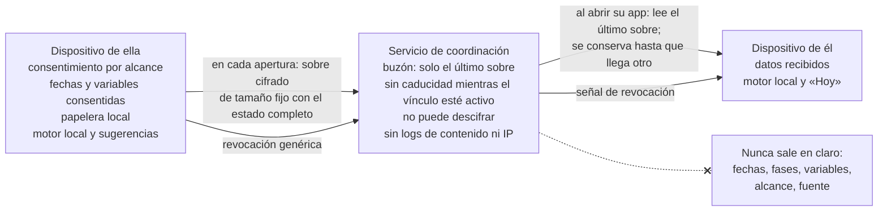

# JUA-42 — Revisión arquitectónica del modelo E

**Estado:** borrador de decisión. Respuestas de producto del 17-11-2026 y revisión del 19-11-2026. Preguntas para la revisión jurídica (§4.6) actualizadas el 24-11-2026. Revisión de producto del 25-11-2026: §4.2 y §8. Decisiones del 26-11-2026: quién puede deshacer el vínculo (§4.3.1, JUA-55) y correo de la §7 (descartado). §4.6 cerrada el 26-11-2026 para la revisión jurídica (JUA-22).
**No modifica todavía** ADR-001, la línea base ni CON-008. **No habilita** datos reales, persistencia, emparejamiento ni piloto.
**Relacionado:** JUA-13 (puerta del modelo E), JUA-28 (formulario de consentimiento), JUA-29 (ADR-003, excepción a ADR-001), JUA-41 (app de ella), JUA-43 (modelo de amenazas), JUA-44 (EIPD y violencia tecnológica), JUA-22 (revisión jurídica), JUA-47 (arquitectura definitiva).

> Este documento no es asesoramiento jurídico. El §4.6 ordena las preguntas para la revisión profesional de JUA-22; no las responde.

## 0. Resumen

| # | Pregunta | Decisión | Estado |
|---|---|---|---|
| 1 | ¿Puede ella guardar sus datos en su dispositivo? | Sí: todo lo que ha compartido. Si borra un dato, se borra también en el dispositivo de él, con aviso previo y posibilidad de deshacer. | Decidido (19-11). Falta fijar retención (§1). |
| 2 | ¿Cómo pasan los datos al dispositivo de él? | Por el servidor, cifrados de extremo a extremo. Un sobre con el estado completo en cada apertura de su app. El buzón guarda solo el último, lo conserva hasta que llega otro y no caduca mientras el vínculo esté activo. | Decidido (19-11), sujeto a ADR-003 y a la revisión jurídica (§4). |
| 3 | ¿Alta a distancia, confirmaciones o las dos? | Las dos. Primera versión: solo relé, sin QR (opción 3). | Decidido (19-11). |
| 4 | ¿Avisos en el dispositivo de ella? | Sugerencias dentro de la app para el piloto. | Decidido (17-11, §3). |
| 5 | ¿Qué puede afirmar la app sobre quién confirmó? | Desbloqueo del dispositivo antes de confirmar. | Decidido (19-11, §5). |
| — | ¿Quién puede deshacer el vínculo? | Los dos. Para ella, deshacer el vínculo es retirar el consentimiento: un solo gesto. Él tiene el suyo, con desbloqueo. | Decidido (26-11, §4.3.1). |
| — | ¿Correo automático a las tres semanas? | No. Era un recordatorio para registrar la regla, y eso ya lo hacen las sugerencias dentro de la app (§3). | Descartado (26-11, §7). |

## 1. Datos en el dispositivo de ella

**Decisión (17-11).** La app de ella guarda en local lo que ha compartido: fechas de inicio de sangrado, duraciones y las variables de la taxonomía local que haya consentido (ADR-002). Amplía la decisión del 13-11 (CON-008 §0.1, punto 1), que solo hablaba de fechas y duraciones.

**Por qué.** Ella es la titular de los datos. Necesita verlos, corregirlos y borrarlos, y su motor local los usa para las sugerencias de actualización.

### 1.1. Borrado y corrección (decidido el 19-11)

* **Lo que ella borra se borra también en el dispositivo de él.** Viaja en el siguiente sobre (§4.4): como cada sobre lleva el estado completo, basta con que el dato ya no esté. No hace falta un tipo de mensaje distinto para corregir.
* **Aviso antes de borrar.** Texto provisional, para JUA-28 y la app de ella:
  > ES: Si borras este dato, también se borrará en el móvil de tu pareja la próxima vez que abra Consona. Puedes deshacerlo durante {N} días.
  > CA: Si esborres aquesta dada, també s'esborrarà al mòbil de la teva parella la propera vegada que obri Consona. Ho pots desfer durant {N} dies.

  Dice «la próxima vez que abra Consona» porque no se puede prometer un borrado instantáneo en un dispositivo que no está conectado (CON-007).
* **Reversible.** El dato borrado se queda en una papelera **solo en el dispositivo de ella** durante {N} días. Si lo recupera, vuelve en el siguiente sobre. Pasado ese plazo, se borra del todo. {N} lo fija la EIPD.
* **Corregir es lo mismo:** ella cambia el dato y el siguiente sobre lleva el valor nuevo.
* **Borrar un dato no es retirar el consentimiento.** Retirarlo sigue el protocolo de CON-007: el dispositivo de él bloquea y borra todo, y para volver hace falta un consentimiento nuevo.

### 1.2. Pendiente

* **Retención.** Propuesta: la misma ventana que en el dispositivo de él (historial de 6 ciclos, DA-10), para que ninguno de los dos guarde más que el otro.

### 1.3. Cambio formal (aceptado el 19-11)

Se modifica el requisito 9 de CON-008 («el dispositivo de control no pide, no muestra y no guarda datos de ciclo»). El cambio se hace cuando se acepte este documento.

## 2. Flujos de datos (primera versión)

| Dato | Dispositivo de ella | Servicio | Dispositivo de él |
|---|---|---|---|
| Consentimiento por alcance | Sí, en claro | Solo el estado técnico `granted` / `revoked` (ya permitido) | Sí, lo que necesita para respetarlo |
| Fechas y duraciones | Sí | Solo cifradas: el último sobre, hasta que llega otro o se cierra el vínculo (**excepción nueva**) | Sí |
| Variables consentidas | Sí | Solo cifradas, igual que las fechas (**excepción nueva**) | Sí, si el alcance lo permite |
| Datos borrados por ella | En la papelera, {N} días | No | No |
| Fase, día, ventana, estimaciones | Las calcula su motor | Nunca | Las calcula su motor |
| Claves de cifrado | Sí | Nunca | Sí |

## 3. Avisos en el dispositivo de ella

**Decisión (17-11).** Para el piloto se mantienen las sugerencias dentro de la app, al abrirla o al volver a ella ([app-ella-sugerencias-v0.1.0.md](../education/app-ella-sugerencias-v0.1.0.md), decisión del 13-11). Sin notificaciones push, sin avisos programados y sin aviso genérico de respaldo.

**Consecuencia aceptada.** Si ella no abre la app, no se le sugiere confirmar, y el dispositivo de él puede pasar a «sin confirmar». Es coherente con S-02: la falta de registro solo significa que falta información.

**Fuera del piloto.** Un aviso fuera de la app solo es posible con una app nativa (notificación local, sin servidor). Web Push queda descartado: el servidor que lo envía sabría cuándo espera ella la regla.

## 4. Paso de datos por el servidor (preguntas 2 y 3)

### 4.1. Qué se propone (aceptado el 19-11)

En el alta, ella decide en su app qué comparte, da su consentimiento y la app envía al dispositivo de él un **sobre cifrado** con los datos. Después, cada vez que ella abre la app, sale un sobre nuevo con el estado completo: si ha confirmado una regla, corregido o borrado algo, va dentro. Los sobres pasan por el servidor de Consona, que no puede leerlos.

**Ventajas:**

* Sirve a parejas que no viven juntas o no coinciden cuando empieza la regla.
* Un solo flujo para consentimiento y datos, sin que él teclee fechas de ella. Es lo que pide la soberanía de ella: la fuente es ella.
* La confirmación llega en cuanto él abre la app, y su estimación mejora.

### 4.2. Qué cambia respecto a lo aprobado

| Documento | Qué dice hoy | Qué habría que cambiar |
|---|---|---|
| ADR-001 §2 | El servicio no puede «recibir, inferir, almacenar, indexar, **transmitir** o registrar» datos de ciclo. Ninguna excepción para contenido cifrado. | ADR-003: excepción para transmitir y guardar temporalmente sobres cifrados de extremo a extremo, con las salvaguardas de §4.4 y §4.5. |
| ADR-001 §4 | Prohíbe «peticiones de seguimiento recurrentes del dispositivo receptor». | ADR-003 debe aclarar que el sobre en cada apertura sale del dispositivo de ella, solo cuando ella abre la app, y no es seguimiento. |
| Línea base §5 | La comodidad no justifica excepciones distintas de la aprobada. | Justificarla por soberanía y viabilidad (la fuente es ella), no por comodidad. |
| CON-008 §0 y §2 | Relé de estados técnicos opacos; rechaza cualquier campo de ciclo. | Nuevo tipo de mensaje: sobre opaco de tamaño fijo, y buzón con borrado por inactividad (§4.3). El rechazo de campos semánticos se mantiene: el servidor solo ve el sobre. |
| JUA-29 | Excepción limitada al alta a distancia. | Ampliar a alta y confirmaciones, y a toda la vida del vínculo. |

**La promesa a ella (19-11).** Propuesta de producto: «Tú decides sobre tus datos, que van cifrados punto a punto y no podemos leer». Revisión:

| Parte | ¿Es cierta? | Ajuste |
|---|---|---|
| «Tú decides sobre tus datos» | Sí en lo que controla la app: qué comparte, corregir, borrar, retirar. No puede impedir que él haga una captura o lo apunte, y el borrado en el móvil de él espera a que abra la app. | Más preciso: «Tú decides qué compartes». Los límites del borrado ya están en el aviso de §1.1. |
| «cifrados punto a punto» | **No es el término correcto.** «Punto a punto» se usa también para el cifrado de cada tramo (como HTTPS), en el que el servidor sí puede leer. Lo que se propone es cifrado **de extremo a extremo**. | «cifrados de extremo a extremo». |
| «no podemos leer» | Sí para el contenido, con dos condiciones: que el emparejamiento se compruebe con el código (§4.4, punto 2) y que la app que servimos sea la que publicamos (§4.4, punto 7). No es cierto para los metadatos: vemos que llega un sobre y cuándo. | Mantener, y explicar en el formulario qué vemos y qué no. |

**Propuesta de texto:**

> ES: Tú decides qué compartes. Tus datos viajan cifrados de extremo a extremo: nosotros no podemos leerlos.
> CA: Tu decideixes què comparteixes. Les teves dades viatgen xifrades d'extrem a extrem: nosaltres no les podem llegir.

Y en «Más información» del formulario (JUA-28):

> ES: Solo vemos que llega un mensaje cifrado y cuándo, no lo que contiene. Guardamos solo el último, hasta que llega uno nuevo. Si ninguno de los dos abre Consona en {plazo}, borramos el mensaje y el vínculo, y para volver a compartir hará falta emparejar de nuevo.
> CA: Només veiem que arriba un missatge xifrat i quan, no què conté. En guardem només l'últim, fins que n'arriba un de nou. Si cap dels dos obre Consona en {termini}, esborrem el missatge i el vincle, i per tornar a compartir caldrà emparellar-vos de nou.

### 4.3. Buzón (decidido el 19-11)

Un servidor solo puede pasar un mensaje sin guardarlo si los dos tienen la app abierta a la vez, así que las confirmaciones necesitan un buzón. **Decisión:** el servidor guarda el último sobre cifrado y se lo entrega a él cada vez que abre la app. Cada sobre nuevo sustituye al anterior (§4.4, punto 5): como mucho hay un sobre por pareja.

**El sobre no caduca mientras el vínculo esté activo** (decisión posterior del 19-11, que sustituye a «caducidad de más de 7 días»). Un plazo fijo podía borrar una confirmación antes de que él la viera, si ninguno de los dos abría la app en ese tiempo.

**El sobre se conserva después de entregarlo** (19-11, sustituye a «se borra al entregarse»). Así, si él recupera su app en un móvil nuevo, lee el estado completo al momento, sin esperar a que ella abra la suya (§8). El sobre solo se borra:

* cuando llega uno nuevo, que lo sustituye;
* cuando se deshace el vínculo, lo haga ella (al retirar el consentimiento) o él (§4.3.1);
* cuando nadie abre la app durante un plazo largo de inactividad (por ejemplo, 90 días). El plazo lo fija la EIPD. Al cumplirse se borran el sobre y el vínculo.

En ADR-003 y en el formulario debe decirse así: «almacenamiento temporal cifrado», no «sin almacenamiento».

#### 4.3.1. Quién deshace el vínculo (decidido el 26-11)

**Decisión.** Los dos pueden deshacerlo, cada uno desde su app y con desbloqueo del dispositivo (§5). Completa la decisión del 24-11 de JUA-55.

| | Ella | Él |
|---|---|---|
| Gesto | **Uno solo:** dejar de compartir. Para ella, retirar el consentimiento y deshacer el vínculo son lo mismo. | Cerrar el vínculo. |
| En el dispositivo de él | Bloqueo y borrado de los datos de ella, derivados, caché y claves del vínculo, según CON-007. | Lo mismo, antes de enviar la señal. |
| En el servidor | Se borran el sobre y el vínculo. | Lo mismo. |
| En el dispositivo de ella | Se borran las claves del vínculo. **Sus datos se quedan**: son suyos y puede borrarlos aparte. | Lo mismo, la próxima vez que abre su app. |
| Para volver | Emparejamiento nuevo con código (§4.4, punto 2) y consentimiento nuevo (CON-007, invariante 10). No se recupera nada del vínculo anterior. | Igual. |

**Por qué un solo gesto para ella.** Un consentimiento retirado con el vínculo vivo dejaría una credencial «dormida» en los dos dispositivos, con la que se podría volver a compartir sin emparejar de nuevo. Es un estado más que probar y un riesgo más en una situación de presión (JUA-44). Con un solo gesto, retirar es siempre empezar de cero.

**El servidor no sabe quién lo cierra.** La señal es la misma venga de quien venga (la revocación genérica de §2). Quién deja a quién también es un dato personal.

**Textos provisionales**, para CON-007 §6 y JUA-28:

* A él, antes de cerrar:
  > ES: Si cierras el vínculo, se borrarán de este móvil los datos que tu pareja compartía contigo. Ella lo verá la próxima vez que abra Consona. Para volver a compartir, tendréis que emparejaros de nuevo y ella tendrá que dar su consentimiento otra vez.
  > CA: Si tanques el vincle, s'esborraran d'aquest mòbil les dades que la teva parella compartia amb tu. Ella ho veurà la propera vegada que obri Consona. Per tornar a compartir, us haureu d'emparellar de nou i ella haurà de tornar a donar el seu consentiment.
* A ella, al abrir su app después:
  > ES: Tu pareja ha cerrado el vínculo en su móvil. Ya no recibe tus datos, y su app ha borrado los que compartías. Tus datos siguen en este móvil. Si queréis volver a compartir, tendréis que emparejaros de nuevo.
  > CA: La teva parella ha tancat el vincle al seu mòbil. Ja no rep les teves dades, i la seva app ha esborrat les que comparties. Les teves dades continuen en aquest mòbil. Si voleu tornar a compartir, us haureu d'emparellar de nou.

  Sin culpa ni alarma, y sin que parezca un error técnico (riesgos de JUA-55). «Su app ha borrado» y no «se han borrado»: la app no puede garantizar que él no haya hecho capturas antes (CON-007).

**Riesgo residual.** Que cerrar el vínculo se use como presión («si no compartes más, me desvinculo»). Va a JUA-44.

**Pendiente en JUA-55:** estados y frases permitidas y prohibidas en CON-007 §6, casos en la matriz de pruebas y pantallas C.1 y C.2 del mapa.

### 4.4. Cifrado

Requisitos mínimos (los detalla CON-015 / JUA-43):

1. **Las claves se crean en los dispositivos y nunca salen de ellos.** El servidor no tiene claves ni copia de seguridad de claves.
2. **Emparejamiento verificado con un código.** En la primera versión no hay QR (opción 3), así que el intercambio de claves pasa siempre por el servidor. Los dos comprueban un código corto (por ejemplo, 6 cifras): en pantalla si están juntos, por teléfono si no. Sin esa comprobación, el propio servidor podría hacerse pasar por él y leer los sobres.
3. **Cifrado autenticado** con primitivas estándar (Web Crypto o libsodium). Nada de criptografía propia.
4. **Sobres de tamaño fijo**, con relleno hasta el máximo posible (6 ciclos y todas las variables). Un sobre con una confirmación y otro sin cambios son indistinguibles.
5. **Cada sobre lleva el estado completo, y el buzón solo guarda el último.** Cambia la propuesta del 17-11, que hablaba de una referencia de un solo uso por sobre:
   * Él tiene que encontrar sus sobres, así que el buzón necesita una referencia que conozcan los dos. Se deriva de la clave compartida y rota cada cierto tiempo.
   * Con un sobre en cada apertura (§4.5), encadenar los sobres de una pareja solo revela cuándo abre ella la app, no cuándo confirma.
   * Con el estado completo no hacen falta sobres de relleno ni de corrección, el orden de llegada no importa y en el servidor hay como mucho un sobre por pareja.
6. **Solo el alcance consentido.** El sobre contiene solo lo que ella ha aceptado compartir, y él rechaza lo que no corresponda a un alcance vigente.
7. **La app que servimos tiene que ser la publicada.** En una app web, quien sirve el código podría cambiarlo para sacar las claves. Es el límite principal de «no podemos leerlos». Mitigación: código público y una huella de cada versión publicada que cualquiera pueda comprobar. CON-030 (JUA-47) decide el mecanismo.

### 4.5. Lo que el servidor ve aunque no pueda leer

**Decisión (19-11): un sobre en cada apertura.** La app de ella envía un sobre de tamaño fijo con el estado completo cada vez que se abre. El servidor ve aperturas de la app, no confirmaciones.

| Metadato | Qué revelaría sin medidas | Medida decidida | Riesgo residual |
|---|---|---|---|
| Momento del envío | La hora de la confirmación es la fecha de inicio de la regla. | Sobre en cada apertura. | Ella puede abrir más la app en los días previstos, porque las sugerencias aparecen en el intervalo (SUG-02). La correlación es más débil, pero existe. Lo evalúa la EIPD. |
| Frecuencia | Un sobre al mes parece una confirmación. | Sobre en cada apertura. | Igual que el anterior. |
| Vínculo entre envíos | Reconstruir el calendario de la pareja. | Buzón con referencia rotatoria; solo el último sobre. | El servidor sabe que un buzón existe y cuándo recibe y entrega sobres. |
| Dirección IP | Identificar y encadenar los envíos. | No registrar IP; proveedor que lo permita (CON-008 §7.2). | El proveedor de red la ve en tránsito. Más adelante, un relé que oculte la IP (Oblivious HTTP, RFC 9458). |
| Tamaño | Distinguir alta, confirmación y corrección. | Tamaño fijo (§4.4, punto 4). | Ninguno relevante. |

**Opciones descartadas:** el envío inmediato solo al confirmar, porque permite inferir la fecha de inicio y ADR-001 §2 prohíbe inferirla, y el retraso aleatorio hasta la siguiente apertura, porque retrasa la confirmación y con un sobre en cada apertura no hace falta. Si la EIPD lo pide, se puede añadir el retraso.

### 4.6. Preguntas para la revisión jurídica (JUA-22)

> **Cerrada el 26-11-2026** para la revisión jurídica (JUA-22). Recoge las decisiones del 19-11 (§1.1, §4.2, §4.3, §4.5, §5 y §8), quién deshace el vínculo (§4.3.1, 26-11) y el descarte del correo (§7, 26-11). Incorpora las preguntas de la ampliación del 13-11 de JUA-22 que siguen vigentes (preguntas 1, 17 y 18); las que hablaban de QR sin servidor quedan sustituidas por la opción 3 (§4.7). Es la lista única de preguntas para la persona revisora: 18 preguntas en ocho bloques.

#### Qué se somete a revisión

La primera versión del modelo E, tal como queda tras el 19-11:

* Ella decide en su app qué comparte y da su consentimiento allí, sin cuenta, correo ni identidad. Antes de confirmar, cambiar el consentimiento o borrar, desbloquea su móvil (§5).
* Cada vez que ella abre su app, sale un sobre cifrado de extremo a extremo, de tamaño fijo, con el estado completo de lo que comparte (§4.1, §4.4).
* El servidor de Consona guarda solo el último sobre de cada pareja. Lo conserva después de entregarlo, sin caducidad mientras el vínculo esté activo, y lo borra al llegar otro, al retirar ella el consentimiento, al deshacerse el vínculo o tras una inactividad larga (§4.3).
* El servidor no tiene claves y no puede leer los sobres. Sí ve que llega un sobre y cuándo; no registra la IP (§4.5).
* El dispositivo de él descifra los datos y calcula la fase en local. Lo que ella borra se borra en el móvil de él la próxima vez que lo abre; en el de ella queda en una papelera local {N} días (§1.1).
* Cada uno puede hacer una copia cifrada y guardarla donde quiera; Consona no la guarda. La de él no lleva datos de ella (§8).
* Cualquiera de los dos puede deshacer el vínculo. Para ella es lo mismo que retirar el consentimiento. Se borran los datos de ella en el móvil de él, el sobre y el vínculo en el servidor, y las claves en los dos; los datos de ella siguen en su móvil (§4.3.1).
* No hay correos, avisos programados ni notificaciones push. Los recordatorios a ella son sugerencias dentro de su app (§3, §7).

#### Puntos de partida, por verificar

* **Transmitir ya es tratamiento.** El RGPD llama tratamiento a la transmisión y a la conservación, aunque sea temporal (art. 4.2). Las fechas de menstruación son datos de salud (art. 9).
* **Datos cifrados.** Para quien tiene las claves (los dispositivos) siguen siendo datos personales. Para el servidor, que no puede descifrarlos, hay debate. Hay jurisprudencia reciente del TJUE sobre el carácter relativo de los datos seudonimizados (C-413/23 P, SEPD contra JUR, 4-9-2025) y unas directrices del CEPD sobre seudonimización (01/2025). Lo prudente es tratarlo como tratamiento de datos de salud y no apoyar el diseño en que no lo sea.
* **Metadatos.** La IP y el momento del envío pueden ser datos personales por sí solos, e incluso datos de salud si permiten inferir la regla (§4.5).
* **Sin identificación.** Consona no puede saber quién es nadie: no hay cuenta, correo ni teléfono. Eso reduce riesgos, pero condiciona cómo se acredita el consentimiento y cómo se atienden los derechos.

#### Preguntas

**A. Papeles y proveedor**

1. ¿Qué papel tiene Consona en el relé (responsable del tratamiento, art. 4.7) y qué papel tiene el proveedor de alojamiento (encargado, art. 28)? ¿Qué región y qué subencargados son aceptables? Si alguno está fuera del EEE, ¿qué exige el capítulo V? Mientras Consona sea un piloto personal y no una entidad, ¿quién es el responsable y qué obligaciones asume como persona física?
2. **Tratamiento en los dispositivos.** La app guarda y calcula datos de salud de ella en el móvil de él, y Consona no puede acceder a ellos. ¿Es Consona responsable de ese tratamiento local porque lo hace su app? ¿Se aplica a él la excepción doméstica (art. 2.2.c)? ¿Cambia algo en el dispositivo de ella, que trata sus propios datos?

**B. Consentimiento e información**

3. ¿Basta el consentimiento explícito de ella (art. 9.2.a) dado en su propia app, sin identidad ni cuenta (DA-09)? ¿Sirve el desbloqueo del dispositivo con passkey (§5) para demostrarlo (art. 7.1), sabiendo que la app solo puede afirmar «confirmado en su dispositivo con su desbloqueo»? ¿Qué registro mínimo hace falta?
4. **La promesa a ella (§4.2).** «Tú decides qué compartes. Tus datos viajan cifrados de extremo a extremo: nosotros no podemos leerlos», con su «Más información» (qué vemos y qué no, y que guardamos solo el último mensaje). ¿Es exacta y suficiente para un consentimiento informado (arts. 12 y 13)? Sus límites: el servidor ve metadatos, «no podemos leerlos» depende de que la app servida sea la publicada (§4.4, punto 7); en una app web, una versión nueva puede activarse sin aviso, y las medidas para evitar una modificación están en CON-030 §9 y el borrado en el móvil de él espera a que lo abra (§1.1).
5. **Los datos de él.** Él también es usuario: su dispositivo guarda el vínculo, sus ajustes y los datos de ella que recibe. ¿Qué base jurídica y qué información necesita él?

**C. Datos cifrados y metadatos**

6. ¿Son datos personales los sobres para el servidor, que no puede descifrarlos? Si lo son, ¿que no pueda descifrarlos reduce obligaciones o solo riesgos?
7. **Aperturas de la app (§4.5).** Con un sobre en cada apertura, el servidor ve cuándo abre ella su app. Como las sugerencias aparecen en el intervalo previsto de la regla (SUG-02), las aperturas pueden concentrarse en esos días. ¿Pueden ser esos metadatos datos de salud? ¿Bastan el tamaño fijo, la referencia rotatoria del buzón y no registrar la IP? ¿Hace falta desde la primera versión un retraso aleatorio o un relé que oculte la IP?

**D. Conservación y supresión**

8. **Buzón (§4.3).** El último sobre se conserva después de entregarlo y no caduca mientras el vínculo esté activo. Se borra tras una inactividad larga (propuesta: 90 días). ¿Es compatible con la limitación del plazo de conservación (art. 5.1.e)? ¿Qué plazo es defendible?
9. **Borrado (§1.1).** Lo que ella borra se borra en el móvil de él la próxima vez que lo abre, y en el de ella queda {N} días en una papelera local para poder deshacerlo. ¿Cumple el derecho de supresión (art. 17) un borrado que espera a la siguiente apertura? ¿Qué plazo {N} es defendible?
10. **Desvinculación (§4.3.1, JUA-55).** Cualquiera de los dos puede deshacer el vínculo. Si lo hace él, su app borra los datos de ella, los derivados y las claves; el servidor borra el sobre y el vínculo, y no sabe quién lo cerró; ella lo ve al abrir su app y conserva sus datos. ¿Es suficiente ese borrado? ¿Basta con informarla en su app la próxima vez que la abre? Tras el cierre, ni el servidor ni el móvil de él conservan nada que acredite que hubo consentimiento; como mucho, el registro queda en el móvil de ella. ¿Choca eso con el deber de demostrarlo (art. 7.1), o prevalece la supresión?
11. **Copias de seguridad (§8).** Cada uno guarda su copia cifrada en su propia nube (Drive, iCloud u otra), fuera del alcance de Consona. La copia de ella puede conservar datos que ella borró después. ¿Qué responsabilidad tiene Consona sobre esas copias y qué hay que informar al crearlas?

**E. Derechos sin identificación**

12. Sin cuenta ni correo, Consona no puede identificar a quien ejerce un derecho (art. 11). ¿Cómo se atienden el acceso, la supresión y la retirada del consentimiento? ¿Basta con que se ejerzan desde la propia app? ¿Qué debe decir la política de privacidad?

**F. Seguridad, EIPD y edad**

13. ¿Bastan las medidas de §4.4, §4.5 y §5 como protección de datos desde el diseño (art. 25) y seguridad (art. 32)?
14. **EIPD (art. 35).** Parece obligatoria: datos de salud, posible situación de vulnerabilidad y tecnología nueva. ¿Entra en la lista de la AEPD de tratamientos que la requieren? ¿Qué alcance mínimo tiene antes del piloto, y debe incluir la evaluación de violencia tecnológica (JUA-44)?
15. **Edad.** El piloto es solo para mayores de 18 años y no hay cuenta. ¿Basta la declaración de edad del onboarding?

**G. Evaluación del piloto**

16. **Lista aparte para evaluar el piloto (JUA-58).** El correo automático a las tres semanas se descarta (§7). Para medir el aprendizaje habrá una lista voluntaria, separada de la app y sin relación con sus datos, como la de aviso de la landing (JUA-32): cuestionarios a él antes y después y, si ella quiere, a ella por separado, sin que él vea sus respuestas. El envío es en fechas fijas para todo el grupo. ¿Qué base jurídica tiene? ¿Pueden ser datos de salud las respuestas sobre el ciclo o el acompañamiento? ¿Se aplica el régimen de investigación (art. 89)? ¿Y la LSSI (art. 21), si los correos no son comerciales?

**H. Calificación del producto y minimización**

17. **Producto sanitario.** La app estima la fase y la próxima regla en el dispositivo, con fines educativos y nunca anticonceptivos ni diagnósticos. ¿Puede eso convertirla en producto sanitario (Reglamento UE 2017/745, regla 11 del anexo VIII)? ¿Qué finalidad declarada y qué avisos lo evitan?
18. **Minimización (art. 5.1.c).** Él ve, si ella lo consiente, la fase estimada, una cuenta atrás de la regla y un calendario con las 6 últimas reglas (DA-10). Ella puede compartir también su franja de edad, que solo sirve para destacar contenido educativo. Su propio móvil conserva el mismo historial que el de él (§1.2). ¿Son proporcionados esos alcances y ese plazo? ¿Es suficiente que cada uno sea opcional y se consienta por separado?

### 4.7. Opciones comparadas

| Opción | Presencia | Servidor ve contenido | Metadatos de ciclo | Encaje con ADR-001 | Complejidad |
|---|---|---|---|---|---|
| 1. Solo QR o proximidad | En el alta y en cada confirmación | No | No | Encaja | Baja |
| 2. Relé solo para el alta (JUA-29 original) | En cada confirmación | No (cifrado) | Bajos: un solo envío | ADR-003 limitado | Media |
| **3. Relé para alta y confirmaciones** | Nunca | No (cifrado) | Mitigados con un sobre en cada apertura (§4.5) | ADR-003 amplio | Alta |
| 4. Opción 3 + QR cuando están juntos | Nunca obligatoria | No (cifrado) | Como la 3 cuando se usa el relé | ADR-003 amplio | Alta |

**Decisión (19-11): opción 3 para la primera versión.** La opción 4 queda para más adelante: añade una vía sin metadatos cuando están juntos, a cambio de un segundo mecanismo que probar.

### 4.8. Decisiones tomadas el 19-11

| Decisión | Resultado |
|---|---|
| Buzón | Aceptado. Solo el último sobre, que se conserva tras entregarlo; sin caducidad mientras el vínculo esté activo; borrado por inactividad larga, con plazo fijado por la EIPD (§4.3). |
| Momento del envío | Un sobre en cada apertura, con el estado completo (§4.5). |
| Opción 3 o 4 | Opción 3 para la primera versión (§4.7). |
| Emparejamiento | Siempre por el servidor, comprobado con un código corto (§4.4, punto 2). |
| Correcciones y borrados | Viajan en el siguiente sobre; borrado reversible con papelera local (§1.1). |
| Orden de trabajo | Actualizar §4.6 y después llevarlo a la revisión jurídica (JUA-22). *(24-11: §4.6 actualizada. 26-11: §4.6 cerrada y enlazada desde JUA-22.)* |
| Cuenta o correo | Fuera de la primera versión. El emparejamiento se hace con un código en la app; CON-008 no cambia en este punto. |
| Varios dispositivos por persona | Fuera de la primera versión. |
| Recuperación | Copia cifrada para los dos, en un archivo que cada uno guarda donde quiera, sin pasar por Consona. La de él no lleva datos de ella (§8). |
| Código de recuperación | Se puede volver a mostrar tras desbloquear el móvil, con la opción «Cambiar código» (§8). |

## 5. Quién confirma (decidido el 19-11)

**Decisión.** Antes de cada confirmación, cada cambio de consentimiento y cada borrado, la app de ella pide el **desbloqueo del dispositivo** (huella, cara o código del móvil) mediante una passkey local con verificación de usuario.

* Si el móvil no tiene bloqueo de pantalla, la app pide activarlo antes de compartir nada. Sin bloqueo no se puede afirmar nada sobre quién confirma.
* CON-030 (JUA-47) debe comprobar que funciona en una PWA en iOS y en Android, y qué pasa si ella cambia de móvil o borra la passkey.

**Lo que la app puede afirmar.** «Confirmado en su dispositivo con su desbloqueo.» No puede afirmar «confirmado por ella»: ninguna app puede garantizar quién tiene el móvil en la mano (CON-008, requisito 10).

**Riesgo residual.** Que alguien la obligue a desbloquear, o que conozca su código. Va al modelo de amenazas (JUA-43) y a la evaluación de violencia tecnológica (JUA-44), junto con la presión para confirmar que ya recoge JUA-13.

## 6. Cambios en otros documentos cuando se acepte

* **ADR-003** (JUA-29): excepción para transmitir y guardar temporalmente sobres cifrados, con alcance «alta y confirmaciones» y las salvaguardas de §4.3 a §4.5.
* **CON-008:** requisito 9 (§1.3), sobre opaco de estado completo, buzón con borrado por inactividad y referencia rotatoria.
* **CON-007** (JUA-55): cierre del vínculo por parte de él, con sus estados, mensajes y casos de prueba; para ella, retirar el consentimiento deshace el vínculo (§4.3.1).
* **Línea base §5:** justificación de la excepción.
* **JUA-28:** promesa nueva (§4.2), aviso de borrado (§1.1), alta a distancia con código y petición de bloqueo de pantalla (§5).
* **JUA-41:** papelera local, sobre en cada apertura, desbloqueo antes de confirmar.
* **JUA-43 y JUA-44:** correlación entre aperturas y regla, emparejamiento a distancia, desbloqueo forzado, integridad del código servido, uso de la copia de él por otra persona (§8).
* **JUA-47 (CON-030):** passkey local en PWA, huella de versiones publicadas.
* **`docs/governance/ruta-critica-modelo-e.md`:** pendiente de actualizar (corte del 2-10-2026).

## 7. Correo automático a las tres semanas (pregunta del 19-11)

**Pregunta.** ¿Se puede enviar un correo automático tres semanas después de la primera vez que se introducen datos?

**Tal como está planteado, choca con lo aprobado:**

* **Hace falta un correo**, y CON-008 §0 prohíbe correo, cuenta y contacto. C2 de ADR-001 pide identificadores no identificativos.
* **El servidor tendría que guardar el correo y la fecha de alta.** Uniría una identidad real con el uso de una app de ciclo y con un momento. Además, la fecha de la primera inserción está cerca de la fecha de la última regla que ella introduce.
* **Si el correo es para ella**, revela que usa Consona a quien tenga acceso a su buzón. En una situación de control coercitivo, eso es un riesgo directo (JUA-44).
* **Es una finalidad nueva** (art. 5.1.b del RGPD), con su propia base jurídica. Si es comercial, la LSSI (art. 21) exige consentimiento previo.

**Alternativas, de menos a más tratamiento:**

1. **Mensaje dentro de la app** a las tres semanas, calculado en el dispositivo. Sin servidor ni correo.
2. **Correo de seguimiento del piloto en una fecha fija para todo el grupo**, a una lista aparte (como la de la landing, JUA-32). Es voluntaria, con su propio consentimiento y sin relación con los datos de la app. El servidor no sabe cuándo se dio de alta nadie.
3. **El planteamiento original**, solo con ADR propio, EIPD y revisión jurídica. No se recomienda.

**Decisión (26-11): se descarta.** El correo era un recordatorio para que ella registrara la regla. Eso ya lo cubren las sugerencias dentro de su app, que aparecen en el intervalo previsto (§3, SUG-02). Las tres semanas también existen ya: el motor usa 21 días como umbral de SUG-04 ([src/motor/README.md](../../src/motor/README.md)). Un correo a las tres semanas de la primera fecha añadiría tres riesgos:

* el momento del envío señalaría la regla siguiente, es decir, un dato de salud inferido en el servidor (ADR-001 §2);
* revelaría el uso de Consona a quien lea su buzón (JUA-44);
* obligaría a guardar su correo y su fecha de alta.

Fuera del piloto, un recordatorio fuera de la app solo sería una notificación local de una app nativa (§3). La evaluación del piloto es otra finalidad: va por una lista aparte, en fechas fijas (JUA-58, alternativa 2), y está en la pregunta 16 de §4.6.

## 8. Copias de seguridad y recuperación (decidido el 19-11)

Sin cuenta ni correo. Cada persona puede hacer una copia cifrada que guarda donde quiera. Consona no la guarda y no puede relacionarla con ninguna pareja.

| | Copia de ella | Copia de él |
|---|---|---|
| Contenido | Sus datos, su consentimiento y la credencial del vínculo | Solo la credencial del vínculo y sus ajustes. **Nunca datos de ella** |
| Al recuperar | Recupera todo y cierra el acceso del móvil perdido | Se reconecta al buzón, lee el último sobre (§4.3) y cierra el acceso del móvil perdido |
| ¿Necesita a la otra persona? | No | No |

**Por qué la copia de él no lleva datos de ella.** Una copia en su nube quedaría fuera del alcance de los borrados y de la retirada del consentimiento de ella (CON-007). Si ella ha retirado el consentimiento, la app de él lo ve al reconectarse y no recibe nada.

**Riesgo residual de la copia de él.** No lleva datos de ella, pero sí la credencial del vínculo. Mientras el vínculo esté activo, quien tenga la copia y su código puede reconectarse y leer el último sobre, es decir, los datos que ella comparte en ese momento. Al recuperar se cierra el acceso del móvil anterior (tabla de arriba): él lo notaría, porque su móvil pierde el acceso; ella, no. Va al modelo de amenazas (JUA-43) y a la evaluación de violencia tecnológica (JUA-44). **Decidido el 26-11 (CON-030, D-08):** la app de ella avisa, como hecho neutro, cuando él recupera Consona en otro móvil.

**Flujo de copia:**

1. Entra en Consona y elige «Crear copia de seguridad».
2. La app pide el desbloqueo del móvil (§5). La primera vez muestra el código de recuperación y pide apuntarlo.
3. Reúne lo que corresponde a su papel (tabla anterior).
4. Lo cifra en el móvil con una clave derivada del código.
5. Genera un archivo con nombre neutro por defecto (por ejemplo, `copia-2026-11-19.bak`), que se puede cambiar. Un nombre con «Consona» revelaría el uso de la app a quien vea su nube (JUA-44).
6. Abre el menú de compartir del móvil (Safari en iOS, Chrome en Android). En ordenador, descarga el archivo.
7. La persona lo guarda en Drive, Archivos, iCloud Drive o donde prefiera.
8. La app recuerda actualizar la copia; a ella, por ejemplo, cuando registra una regla.

**Código de recuperación:**

* Se puede volver a mostrar mientras se tiene el móvil, siempre tras desbloquearlo.
* Si se pierde el móvil sin haberlo apuntado, la copia no se puede abrir. Nosotros tampoco podemos. Hay que decirlo al crear la copia.
* «Cambiar código» genera un código nuevo y una copia nueva. Las copias antiguas siguen abriéndose con el código antiguo: la app sugiere borrarlas.
* Más adelante: sustituir el código por una passkey sincronizada (extensión PRF de WebAuthn), si funciona en iOS y Android.

**Fuera de la primera versión:** cuenta, correo, varios dispositivos por persona y copia automática.
